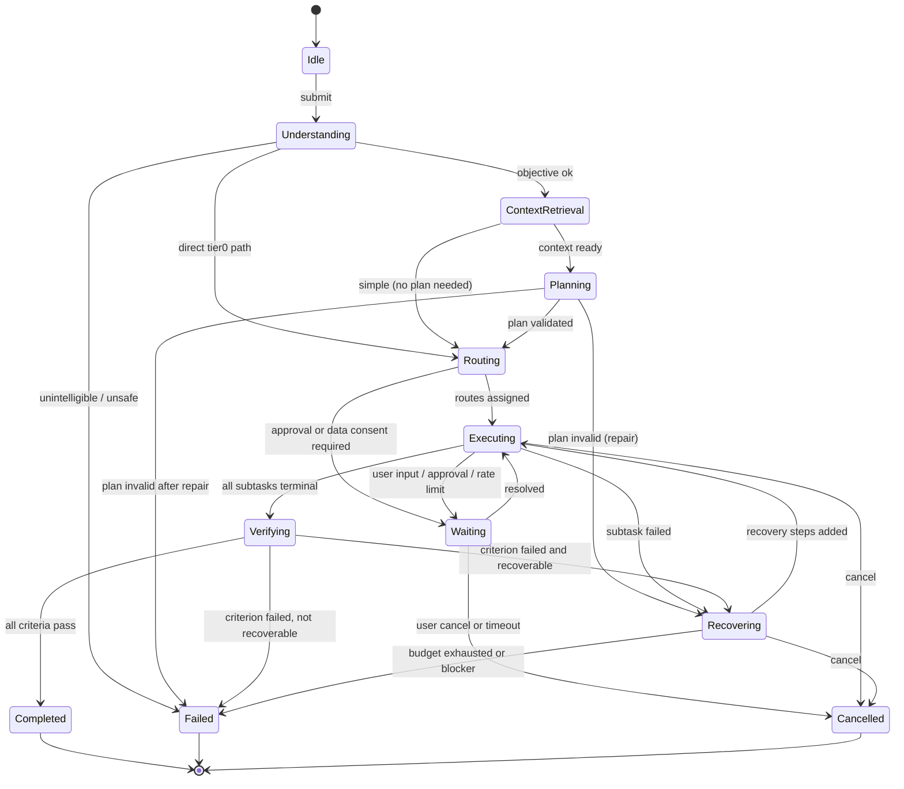
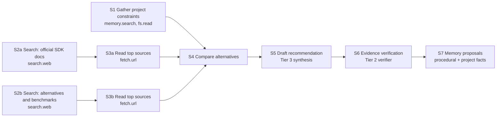

# EDITH — Agent Orchestration Design

Companion: [DETAILED_SYSTEM_DESIGN](EDITH_DETAILED_SYSTEM_DESIGN.md) §3.2, §3.5, §3.6 · [MODEL_ROUTING](EDITH_MODEL_ROUTING_DESIGN.md) · [SECURITY](EDITH_SECURITY_AND_AUTONOMY_POLICY.md)

## 1. Purpose

The orchestrator manages the full lifecycle of every task: understanding, context, planning, routing, execution, verification, recovery, memory update, and reporting. It is the only component allowed to change task state. It is deliberately **independent of any model**: a task can be created, cancelled, inspected and recovered with every model offline.

## 2. Concepts

| Term | Definition |
|------|------------|
| Task | One objective from one origin (text, voice, schedule), with a state, budget and outcome |
| Plan | A DAG of subtasks with declared capabilities and verification criteria |
| Subtask | A unit of execution: one capability invocation, or one model step, or one verification |
| Worker | A bounded executor for a class of subtask (research, repo, memory, synthesis, verifier) |
| Step | One attempt at a subtask (retries create new steps) |
| Checkpoint | A persisted snapshot of task state and completed step outputs |
| Budget | Limits on time, tokens, tool calls, cost and parallelism for a task |

Workers are not free-running agents. Each worker is a function with a typed input, a capability allowlist and a budget. The orchestrator owns the objective. Workers return typed results only.

## 3. Lifecycle

The lifecycle follows the thirteen steps of the specification. Each step maps to a state.

| # | Step | State | Exit condition |
|---|------|-------|----------------|
| 1 | Receive intent | `Idle → Understanding` | Request accepted and persisted |
| 2 | Understand objective | `Understanding` | Objective, constraints and success criteria extracted |
| 3 | Retrieve context | `ContextRetrieval` | Memory and context results assembled within budget |
| 4 | Determine complexity | `Understanding` (sub-step) | Complexity class: T0 / simple / complex |
| 5 | Select strategy | `Planning` (entry) | Strategy: direct tool, single-model answer, plan-and-execute |
| 6 | Create plan | `Planning` | Plan validated |
| 7 | Select models, skills, tools | `Routing` | Route decision recorded for each subtask |
| 8 | Execute | `Executing` | All subtasks terminal |
| 9 | Observe | `Executing` | Results recorded |
| 10 | Verify | `Verifying` | Each criterion has a verdict |
| 11 | Recover | `Recovering` | Recovery plan applied or blocker declared |
| 12 | Update memory | `Verifying` (post) | Memory proposals submitted |
| 13 | Communicate | terminal | Activity summary and final message emitted |

`Waiting` is entered whenever a subtask awaits user input, an approval, an external event, or a rate-limit window.

## 4. State machine

Rules:

- Every transition writes a `task_event` row before side effects happen (write-ahead).
- `Completed` requires verification results. A task with no verifiable criteria must declare a **verification mode** (`mechanical`, `evidence`, `user-confirmed`, or `none-declared`). `none-declared` is shown in the UI as "unverified".
- Cancellation propagates through a cancellation tree: task → subtasks → model streams → tool processes.

## 5. Task management

- **Priority:** `interactive` (user is waiting) > `background` (scheduled, memory consolidation) > `idle`. Interactive tasks preempt background worker slots.
- **Concurrency:** global limit (default 4 worker slots), per-provider limits from the router, per-tool-class limits (for example at most 2 concurrent `process` tools).
- **Persistence:** tasks and events in SQLite; a restart marks in-flight tasks `Waiting(ResumeRequired)` and offers to resume; idempotent tools resume automatically, non-idempotent ones require confirmation.

## 6. Worked example — "research architecture and prepare recommendation"

Objective: research options for a Rust-based MCP host, compare alternatives, and produce a recommendation for the owner's project.

1. **Understand:** classified as `complex`, verification mode `evidence`. Constraints extracted: must be Rust, must support stdio and HTTP transports.
2. **Context:** memory search for the project (`explicit` facts about the project); active project path if context source enabled.
3. **Plan (DAG):**

4. **Routing:** S1 deterministic; S2a/S2b and S3 are tool calls with no model; S4 Tier 3 reasoning; S5 Tier 3; S6 Tier 2 verifier; S7 Tier 1 extractor.
5. **Execution:** S2a and S2b run in parallel (independent, I/O-bound, measured benefit); S3a and S3b run in parallel after their searches; S4 waits for both.
6. **Verification:** each claim in S5 must map to a span from S3a or S3b. Unmapped claims are flagged, and S5 is revised once.
7. **Output:** recommendation with a comparison table, citations, and an "unverified assumptions" section.

Parallelism is justified here because the two searches are I/O-bound and independent. The orchestrator does not parallelise reasoning steps that depend on each other.

## 7. Worked example — "fix the authentication issue in my repository"

1. Understanding: `complex`, verification `mechanical` (tests).
2. Context: project path, `git.status`, memory search for project conventions.
3. Plan: locate auth code → reproduce failing test → propose patch → apply patch (write, policy-gated) → run `cargo test` or project test template → verify test result → summarise diff.
4. Routing: locating and reasoning use Tier 2–3; patch generation Tier 3; test execution Tier 0 tool.
5. Policy: `fs.write` inside project allowed (`PolicyControlled` if more than the configured file count, default 5 files); test command is an allowlisted template.
6. Verification: tests must pass; if they still fail, Recovering with one more attempt, then `Failed` with the failing output and a diff summary.
7. Reporting: changed files, test output, what could not be resolved.

## 8. Retry, timeout and cancellation policies

| Policy | Default |
|--------|---------|
| Model call timeout | 60 s for Tier 2/3 first token + stream idle timeout 20 s |
| Tool call timeout | Per-tool descriptor; default 30 s; process tools 120 s |
| Retries on transient error | 3 attempts, exponential backoff with jitter (0.5 s base) |
| Retries on invalid output | 1 repair attempt, then escalate tier once |
| Task wall-clock budget | 15 min interactive, 60 min background; user-adjustable |
| Cancellation latency | Model stream stops within 200 ms; tool process gets SIGTERM then SIGKILL after 2 s |

## 9. Subtask dependencies and agent handoffs

- A subtask may depend on other subtasks by ID. The output of each dependency is passed as a typed artifact reference, not as raw text in the prompt.
- Handoffs between workers pass an `Artifact` (for example `SourceSet`, `Draft`, `Patch`, `TestReport`) with provenance. Workers never see artifacts they did not declare as inputs.

## 10. Progress reporting

Progress is reported as: current state, current subtask label, completed/total subtasks, elapsed time, and the active model or tool name. No token-by-token reasoning is displayed. Streaming text answers stream to the conversation, not the activity center.

## 11. Verification modes

| Mode | Used for | Oracle |
|------|----------|--------|
| `mechanical` | Code changes, file operations, data transforms | Test exit codes, file hashes, schema validation |
| `evidence` | Research, comparison, summary | Claim-to-source mapping, source quality checks |
| `user-confirmed` | Subjective or irreversible outcomes | User accepts in UI |
| `none-declared` | Quick answers, opinions | Labelled "unverified" |

## 12. Execution tracing

Each task has a `trace_id`. Each step records: route, provider/model id, capability id, input hash (not content by default), output size, latency, error, policy decision id, and retry count. Traces are viewable in the Activity Center and in the diagnostics export.

## 13. Failure handling summary

See [DETAILED_SYSTEM_DESIGN](EDITH_DETAILED_SYSTEM_DESIGN.md) §4.2 for the recovery flowchart. Principle: a task is never reported as complete with an unexplained failed step.

## 14. Testing

- State machine property tests: no transition outside the table; every path reaches a terminal state under fault injection.
- Scenario tests for the eight interaction scenarios in the specification (see [TESTING](EDITH_TESTING_AND_EVALUATION_PLAN.md) §5).
- Cancellation tests: cancel at every state; assert no leaked child processes or streams.
