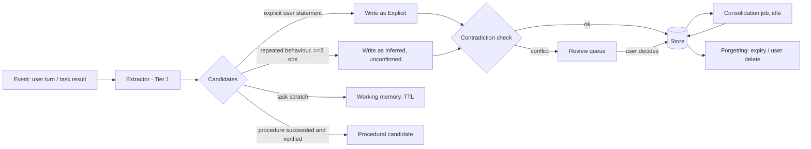
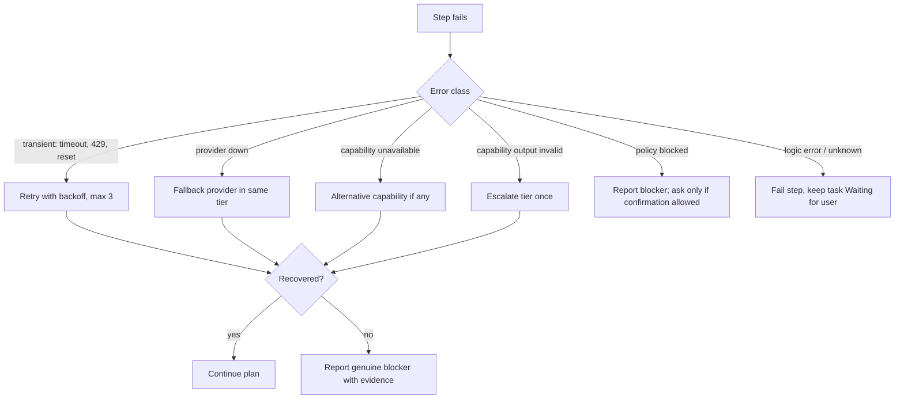
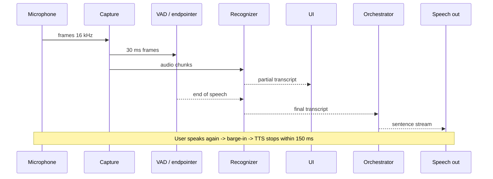

# EDITH — Detailed System Design

Companion: [HIGH_LEVEL_ARCHITECTURE](EDITH_HIGH_LEVEL_ARCHITECTURE.md) · [API_AND_EVENT_CONTRACTS](EDITH_API_AND_EVENT_CONTRACTS.md) · [DATABASE_DESIGN](EDITH_DATABASE_DESIGN.md)

Each subsystem section lists: **Purpose · Responsibilities · Inputs · Outputs · Dependencies · Internal interfaces · External interfaces · Data structures · State · Failure modes · Security · Testing · Performance**. Where a field is not applicable it is stated.

## 0. Shared conventions

- Identifiers: `TaskId`, `SubtaskId`, `SessionId`, `TurnId`, `RouteId`, `MemoryId`, `CapabilityId`, `TraceId` are UUID v7 newtypes (time-ordered).
- Time: UTC in storage; displayed in the user's timezone (default `Asia/Dhaka` configured at setup).
- Errors: each crate defines a `thiserror` enum; the daemon maps them to a stable `ErrorCode` (see API doc §5).
- Configuration: TOML file validated at load into typed structs; unknown keys are errors.
- Secrets: never stored in TOML; referenced by key name (`secret_ref = "gemini.api_key"`).

## 1. Core domain types (in `edith-core`)

```rust
pub enum TaskState { Idle, Understanding, ContextRetrieval, Planning, Routing,
                     Executing, Waiting, Verifying, Recovering, Completed, Failed, Cancelled }

pub enum Tier { T0Deterministic, T1Light, T2General, T3Advanced, T4Specialist }

pub enum CapabilityKind { Instruction, NativeTool, McpTool, ExternalService }

pub enum AutonomyClass { Automatic, PolicyControlled, ConfirmRequired, Blocked }

pub enum Provenance { Explicit, Inferred, Temporary, Assumption, Outdated }

pub enum DataClass { Public, Personal, Project, Secret }   // routing and cloud consent use this
```

`DataClass::Secret` content may never leave the device, is never written to memory, and is redacted from traces.

## 2. Process composition

`edith-daemon` is the composition root. It reads config, constructs services in dependency order, starts supervisors, and exposes the local API. Construction order:

1. `edith-core` (config, types) → 2. `edith-observability` → 3. `edith-events` (bus) → 4. `edith-storage` (migrations run here) → 5. `edith-policy` → 6. `edith-memory` → 7. `edith-models` + `edith-router` → 8. `edith-tools` → 9. `edith-mcp` (lazy child start) → 10. `edith-skills` → 11. `edith-search` → 12. `edith-context` → 13. `edith-voice` (only if enabled) → 14. `edith-orchestrator` → 15. `edith-api`.

Startup budget: see [PERFORMANCE_REQUIREMENTS](EDITH_PERFORMANCE_REQUIREMENTS.md) §2. Heavy components (models, MCP children, voice) are lazy.

## 3. Subsystems

### 3.1 Rust application core (`edith-daemon`, `edith-core`)

- **Purpose:** process lifecycle, configuration, composition, shutdown.
- **Responsibilities:** load and validate config; construct services; run supervisors; handle SIGTERM with a 5-second graceful drain (cancel tasks, flush storage, stop children).
- **Inputs:** config file, environment, signals. **Outputs:** running services, health state.
- **Dependencies:** none upward. Everything depends on `edith-core`.
- **Interfaces:** `Daemon::start(config) -> DaemonHandle`, `DaemonHandle::shutdown()`.
- **Failure modes:** invalid config → refuse start with a line-precise error; storage migration failure → refuse start, keep old database untouched (backup before migration).
- **Security:** runs as the user, never as root. No privileged helper in v1.
- **Testing:** config fuzzing; start/stop integration test with fakes; shutdown drains within budget.

### 3.2 Agent runtime (`edith-orchestrator`, runtime half)

- **Purpose:** executes task state machines and worker tasks. Detailed in [AGENT_ORCHESTRATION](EDITH_AGENT_ORCHESTRATION_DESIGN.md).
- **Inputs:** `TaskRequest` from conversation or voice. **Outputs:** `TaskEvent` stream; final `TaskOutcome`.
- **Dependencies:** planner, router, tools, memory, search, context, policy, store, bus.
- **Interfaces:** `Orchestrator::submit(TaskRequest) -> TaskHandle`; `TaskHandle::{cancel, subscribe, wait}`.
- **Failure modes:** worker panic → caught, mapped to `WorkerFailed`; deadlock prevented by per-step timeouts; crash → tasks resume from last checkpoint on restart.
- **Performance:** no blocking calls on the orchestrator loop.

### 3.3 Model provider abstraction (`edith-models`)

- **Purpose:** uniform inference contract; no agent code knows a vendor.
- **Trait (sketch):**

```rust
#[async_trait]
pub trait ModelProvider: Send + Sync {
    fn id(&self) -> ProviderId;
    fn capabilities(&self) -> &ModelCapabilities;   // tool_calls, json_mode, streaming, max_ctx, thinking_mode, data_residency
    async fn health(&self) -> ProviderHealth;
    async fn chat(&self, req: ChatRequest, cancel: CancelToken) -> Result<ChatStream, ModelError>;
    async fn embed(&self, req: EmbedRequest) -> Result<Vec<Vec<f32>>, ModelError>;
}
```

- **Adapters (v1):** `OllamaProvider` (OpenAI-compatible `/v1` endpoints), `LlamaCppProvider` (OpenAI-compatible server), `OpenAiCompatibleCloud` (opt-in), `GeminiLiveProvider` (speech only, Phase 11). Optional `RigBackend` behind a feature flag.
- **Connection pooling:** one `reqwest::Client` per provider with HTTP/2 where supported; keep-alive; configurable concurrency limit (semaphore per provider).
- **Failure modes:** timeout, 429, connection refused, model not loaded, context overflow, malformed tool call. Each maps to `ModelError` variants and feeds the router's health table.
- **Security:** cloud adapters refuse requests whose `DataClass` the provider is not consented for.
- **Testing:** contract test suite run against every adapter (see [TESTING](EDITH_TESTING_AND_EVALUATION_PLAN.md) §3.2); recorded fixtures for Ollama responses.

### 3.4 Intelligent model router (`edith-router`)

Detailed in [MODEL_ROUTING_DESIGN](EDITH_MODEL_ROUTING_DESIGN.md). Summary interface:

```rust
pub fn decide(&self, step: &StepSpec, ctx: &RoutingContext) -> RouteDecision;
pub struct RouteDecision { pub tier: Tier, pub provider: ProviderId, pub model: ModelId,
                           pub reason: RouteReason, pub fallbacks: Vec<ProviderModel>, pub data_class: DataClass }
```

### 3.5 Planning engine (`edith-orchestrator`, planner module)

- **Purpose:** converts an objective into a `Plan`: subtasks, dependencies, required capabilities, verification criteria, budget.
- **Inputs:** objective, retrieved context, capability catalogue (filtered). **Outputs:** `Plan` (DAG). Validated for cycles and unknown capabilities before execution.
- **Planner tiers:** deterministic plan templates for known intents (for example "repo status"); Tier 2/3 model planning for novel objectives. Plans are always validated by code, not trusted.
- **Failure modes:** invalid plan JSON → one repair attempt with the validator's error, then escalate tier, then `Failed(PlanInvalid)`.

### 3.6 Task orchestration (`edith-orchestrator`, lifecycle half)

- Owns state transitions (see §5 of [AGENT_ORCHESTRATION](EDITH_AGENT_ORCHESTRATION_DESIGN.md)), subtask scheduling, timeouts, retries, cancellation tree, checkpoints.
- Persists every transition as an event in `task_events` before acting on it (write-ahead).

### 3.7 Tool registry (`edith-tools`)

- **Purpose:** native Rust tools with typed arguments, JSON Schema, risk metadata and a uniform invocation path through the policy engine.
- **Tool descriptor:** `name`, `description`, `input_schema`, `output_schema`, `side_effects: {none|read|write|network|process|system}`, `default_autonomy`, `timeout`, `idempotent: bool`.
- **Native tools (v1):** `clock.now`, `calc.eval` (bounded expression grammar, no code execution), `system.status`, `fs.read` (scoped), `fs.write` (scoped, policy-gated), `git.status`, `git.diff`, `process.run_template` (fixed templates only), `memory.search`, `memory.propose`, `search.web`, `fetch.url`.
- **Invocation:** `ToolInvocation → PolicyDecision → execute → ToolResult → audit`. No tool can be invoked without a `PolicyDecision`.

### 3.8 MCP runtime (`edith-mcp`)

Detailed in [MCP_AND_SKILL_ARCHITECTURE](EDITH_MCP_AND_SKILL_ARCHITECTURE.md) §4. Summary:

- Uses `rmcp` for protocol handling; EDITH wraps it behind `McpClient`.
- Transports: stdio (daemon launches child with a minimal environment allowlist) and Streamable HTTP (TLS required unless `localhost`).
- Lifecycle: `Configured → Starting → Ready → Degraded → Stopped | Unavailable`, with backoff restarts (max 5, then `Unavailable` until user action).

### 3.9 Skill registry (`edith-skills`)

Detailed in [MCP_AND_SKILL_ARCHITECTURE](EDITH_MCP_AND_SKILL_ARCHITECTURE.md) §5–6. Skills are loaded on demand; only skill **descriptions** are indexed for selection.

### 3.10 Memory engine (`edith-memory`)

Detailed in [MEMORY_ARCHITECTURE](EDITH_MEMORY_ARCHITECTURE.md). Four stores behind one `MemoryService` facade.

### 3.11 Conversation manager (`edith-orchestrator`, conversation module)

- **Purpose:** sessions and turns; assembles the context window for each model call; manages interruption and follow-up linkage.
- **Context assembly (per model call):** system contract (short) → active task working memory → pinned semantic facts (only `explicit`/accepted) → retrieved episodic snippets (top-k, token-budgeted) → recent turns (sliding window) → tool schemas for the *selected* capabilities only.
- **Token budget:** fixed fractions per section, configurable; overflow drops lowest-ranked snippets first, never the user's latest message or the system contract.
- **Interruption:** a new user turn during `Executing` or speech output produces an `Interrupt` event; the orchestrator decides `cancel`, `pause`, or `continue` by policy (default: cancel speech, pause task, re-plan if the new message changes the objective).

### 3.12 Voice engine (`edith-voice`)

Detailed in [VOICE_ARCHITECTURE](EDITH_VOICE_ARCHITECTURE.md). Owns the voice session state machine and the endpointing policy.

### 3.13 Audio capture (`edith-voice::capture`)

- Enumerates devices; opens a PipeWire or ALSA stream at 16 kHz mono (resampled if needed); pushes frames into a ring buffer.
- Recovers from device removal by reopening the default device with backoff and emitting `AudioDeviceChanged`.

### 3.14 Speech recognition (`edith-voice::asr`)

- `trait SpeechRecognizer { fn start(&self, cfg) -> AsrSession; }` with `push_audio`, `partials()`, `finals()`, `finish()`.
- Adapters: `WhisperCppRecognizer` (local, chunked streaming with a sliding window), `GeminiLiveRecognizer` (cloud, opt-in).

### 3.15 Speech generation (`edith-voice::tts`)

- `trait SpeechSynthesizer { fn speak(&self, text_stream) -> SpeechHandle; }` supports cancellation and sentence-level chunking so speech starts before the full answer is generated.

### 3.16 Search subsystem (`edith-search`)

Detailed in [SEARCH_ARCHITECTURE](EDITH_SEARCH_ARCHITECTURE.md).

### 3.17 Browser integration (`edith-search::browser`, Phase 12)

- Read-only page extraction first (HTTP fetch + readability extraction). Headless browser later, behind policy. No credential-bearing sessions in v1.

### 3.18 Context acquisition (`edith-context`)

- **Sources (opt-in each):** active project path (configured roots), git status of the active project, recently modified files in the project, system status (battery, network, load), focused application name where the desktop exposes it (later phase).
- **Policy:** context is collected only when a task asks for it or a standing user rule enables it; every collection event is stored with source, time and size; no screen capture or keystroke capture in any version without a new design review.
- **Representation:** `ContextSnapshot { source, observed_at, summary, raw_ref? }`; raw content is not stored by default.

### 3.19 Desktop integration (`apps/desktop`)

- System tray with status, global shortcut to toggle overlay, desktop notifications for task completion or confirmation requests, autostart via systemd user unit.
- Overlay has three modes (see [UI_UX](EDITH_UI_UX_SPECIFICATION.md) §3.6).

### 3.20 Event bus (`edith-events`)

- In-process typed bus built on Tokio broadcast channels for fan-out and bounded mpsc for work queues. Envelope:

```rust
pub struct EventEnvelope { pub id: EventId, pub at: DateTime<Utc>, pub trace: TraceId,
                           pub task: Option<TaskId>, pub kind: EventKind, pub payload: serde_json::Value }
```

- Persisted events: task lifecycle, route decisions, tool invocations, policy decisions, memory writes. Not persisted: audio levels, token deltas (only final text is persisted).
- Lagging subscribers receive `Lagged(n)` and must resynchronise from the store.

### 3.21 Persistence layer (`edith-storage`)

Detailed in [DATABASE_DESIGN](EDITH_DATABASE_DESIGN.md). SQLite via `sqlx`, WAL, migrations embedded, single writer.

### 3.22 Security and permission engine (`edith-policy`)

Detailed in [SECURITY_AND_AUTONOMY_POLICY](EDITH_SECURITY_AND_AUTONOMY_POLICY.md). Pure function `evaluate(request, policy_set) -> PolicyDecision`; no I/O in the evaluator, so it is exhaustively testable.

### 3.23 Observability (`edith-observability`)

- `tracing` spans per task, step and tool call; OpenTelemetry-compatible field names; local JSON-lines log with rotation.
- Metrics: counters and histograms for latency, errors, route usage, tokens (estimated), tool outcomes. Exposed to the UI through the diagnostics API; no external telemetry by default.
- Diagnostics bundle export redacts `DataClass::Secret` and any content flagged `Personal` unless the user chooses to include it.

### 3.24 Frontend interface (`apps/desktop/ui`)

Detailed in [FRONTEND_DESIGN_SYSTEM](EDITH_FRONTEND_DESIGN_SYSTEM.md). Typed service adapters: `RealAdapter` (local API) and `MockAdapter` (prototype).

## 4. Data-flow diagrams

### 4.1 Memory lifecycle



### 4.2 Error recovery



### 4.3 Voice processing



## 5. State management summary

| State | Owner | Persisted | Recovery |
|-------|-------|-----------|----------|
| Task state | Orchestrator | Yes, event log | Replay log; resume at last checkpoint |
| Conversation | Conversation manager | Yes | Reload from store |
| Working memory | Memory engine | Yes, with TTL | Expires on restart if idle > TTL |
| Route health | Router | No (rebuilt) | Probes on startup |
| MCP lifecycle | MCP runtime | No | Restart children on demand |
| Voice session | Voice engine | No | Restart session; no audio replay |
| UI state | Frontend | No | Rehydrate from API |

## 6. Failure-mode catalogue (summary)

| Failure | Detected by | Response |
|---------|-------------|----------|
| Model server down | Health probe, request error | Fallback route; UI route badge changes |
| MCP child crashes | Supervisor | Restart with backoff; mark tools unavailable |
| Search provider rate-limited | 429 | Provider fallback; cache hit preferred |
| Microphone removed | Capture error | Reopen default device; notify |
| SQLite busy | Timeout on writer | Retry with jitter; alert after 3 failures |
| Disk full | Write error | Pause writes, stop non-essential jobs, notify |
| Policy engine error | Panic guard | Fail closed (block action) |
| Clock skew | Monotonic vs wall-clock delta | Use monotonic for durations; log skew |

## 7. Security requirements (summary)

- No open TCP ports by default. Local API uses a Unix socket with `0600` permissions.
- MCP child processes receive an environment allowlist; secrets only when the server config references them.
- No `sh -c` anywhere in the codebase for model-influenced input. Enforced by a lint rule ([TESTING](EDITH_TESTING_AND_EVALUATION_PLAN.md) §4).
- Every side-effecting tool call is audited with the policy decision.

## 8. Testing requirements (summary)

Unit tests for pure logic (router, policy, planner validation, memory contradiction rules). Integration tests with fake providers, fake MCP servers and recorded audio. End-to-end tests of the UI against the local API. Full matrix in [TESTING](EDITH_TESTING_AND_EVALUATION_PLAN.md).
