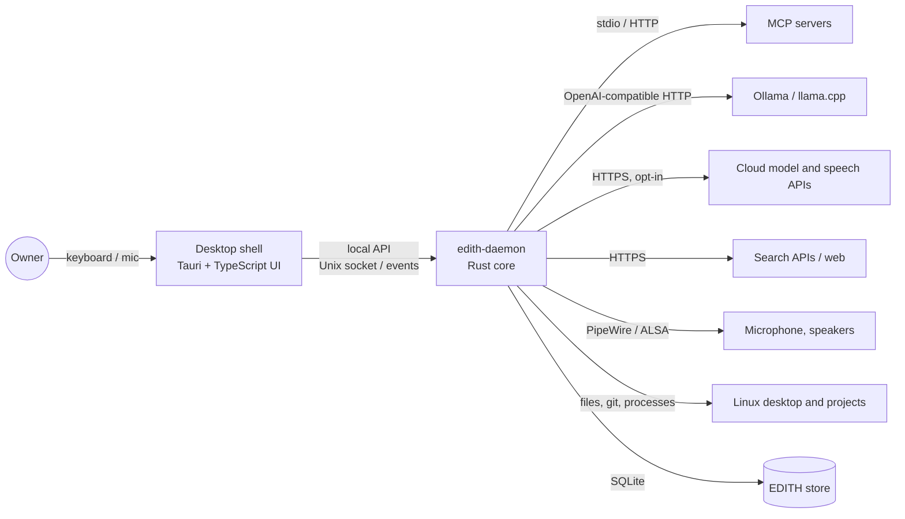
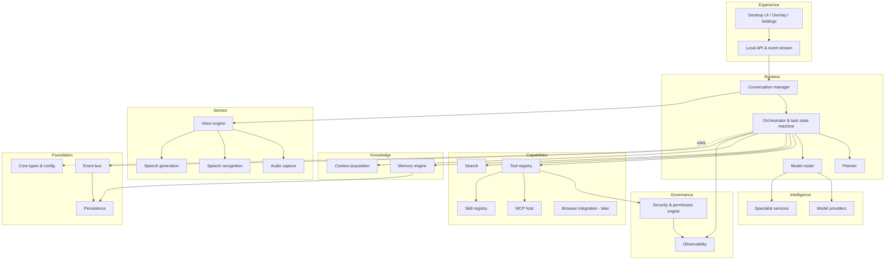
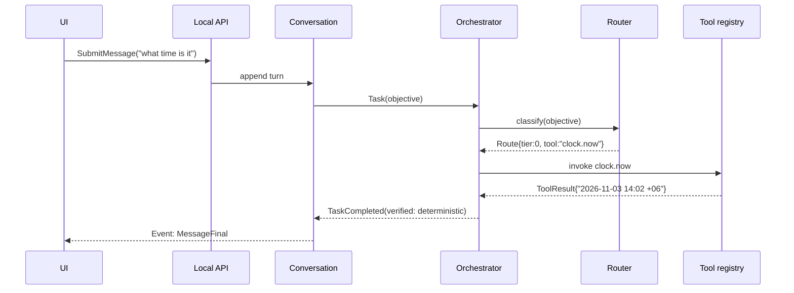

# EDITH — High-Level Architecture

Companion: [DETAILED_SYSTEM_DESIGN](EDITH_DETAILED_SYSTEM_DESIGN.md) · [PROJECT_STRUCTURE](EDITH_PROJECT_STRUCTURE.md) · [TECHNOLOGY_DECISIONS](EDITH_TECHNOLOGY_DECISIONS.md)

## 1. Architectural style

EDITH is a **single local daemon** (`edith-daemon`) that hosts a modular Rust core, plus a **desktop shell** (Tauri) that is a client of the daemon. External processes are used only where isolation or an existing product requires it:

| External process | Why it is separate |
|------------------|--------------------|
| MCP server processes (stdio) | They are third-party code; the MCP host launches them with restricted environments |
| Ollama / llama.cpp server | Existing inference runtimes with their own lifecycle and GPU ownership |
| Whisper worker (optional) | Crash isolation for audio decoding and GPU memory; can be linked instead when stable |
| Desktop shell (Tauri) | UI rendering and window management belong to the windowing system |

No microservices. No message broker. Internal communication uses in-process typed channels and an internal event bus (Tokio broadcast channels), and external communication uses one local API.

## 2. Context diagram

## 3. Subsystem map

The 24 subsystems from the specification are grouped into eight layers. Each subsystem has a crate (see [PROJECT_STRUCTURE](EDITH_PROJECT_STRUCTURE.md)).

## 4. Subsystem responsibilities (summary)

| # | Subsystem | One-line responsibility | Detail doc |
|---|-----------|-------------------------|------------|
| 1 | Rust application core | Process lifecycle, config, composition root | DETAILED_SYSTEM_DESIGN §3.1 |
| 2 | Agent runtime | Executes task state machines and workers | AGENT_ORCHESTRATION |
| 3 | Model provider abstraction | Uniform `ModelProvider` contract for all inference | MODEL_ROUTING §3 |
| 4 | Intelligent model router | Chooses tier, model and fallback per step | MODEL_ROUTING |
| 5 | Planning engine | Turns objectives into subtask graphs with verification criteria | AGENT_ORCHESTRATION §4 |
| 6 | Task orchestration | Owns the lifecycle, dependencies, cancellation and retries | AGENT_ORCHESTRATION |
| 7 | Tool registry | Typed native tools with schemas and risk metadata | MCP_AND_SKILL §3 |
| 8 | MCP runtime | MCP client host, registry, lifecycle, discovery | MCP_AND_SKILL §4 |
| 9 | Skill registry | Skill discovery, manifests, adapters, enable/disable | MCP_AND_SKILL §5–6 |
| 10 | Memory engine | Four memory types, extraction, retrieval, consolidation | MEMORY |
| 11 | Conversation manager | Sessions, turns, interruption, context assembly | DETAILED_SYSTEM_DESIGN §3.11 |
| 12 | Voice engine | Voice session state machine, endpointing, barge-in | VOICE |
| 13 | Audio capture | Device enumeration, streaming capture, recovery | VOICE §4 |
| 14 | Speech recognition | Streaming ASR behind `SpeechRecognizer` | VOICE §5 |
| 15 | Speech generation | TTS behind `SpeechSynthesizer` | VOICE §6 |
| 16 | Search subsystem | Providers, queries, source reading, evidence extraction | SEARCH |
| 17 | Browser integration | Deferred to Phase 12; read-only page extraction first | SEARCH §7 |
| 18 | Context acquisition | Opt-in environment sources (git, project, focus) | DETAILED_SYSTEM_DESIGN §3.18 |
| 19 | Desktop integration | Tray, notifications, global shortcut, overlay windows | UI_UX §3 |
| 20 | Event bus | Typed, traced events inside the daemon | API_AND_EVENT_CONTRACTS §3 |
| 21 | Persistence layer | SQLite store, migrations, repositories | DATABASE_DESIGN |
| 22 | Security and permission engine | Policy decisions, approvals, audit | SECURITY |
| 23 | Observability | Traces, metrics, logs, diagnostics export | DETAILED_SYSTEM_DESIGN §3.23 |
| 24 | Frontend interface | Typed UI with service adapters | FRONTEND_DESIGN_SYSTEM |

## 5. Primary data flows

### 5.1 Text request, Tier 0

No model is loaded for this path.

### 5.2 Objective request, Tier 3 with tools

Detailed in [AGENT_ORCHESTRATION](EDITH_AGENT_ORCHESTRATION_DESIGN.md) §6. Summary: retrieve memory, plan, route each subtask, execute independent subtasks in parallel within budget, verify each output, synthesise, update memory, report.

### 5.3 Voice request

Microphone → capture → VAD endpoint → streaming ASR partials to UI → final transcript becomes a normal user message with `source=voice` → standard task path → response text → TTS streamed to speakers. Barge-in cancels TTS and, if needed, the task. See [VOICE](EDITH_VOICE_ARCHITECTURE.md).

## 6. Process and threading model

| Component | Runtime | Notes |
|-----------|---------|-------|
| `edith-daemon` | Tokio multi-thread runtime | One runtime; CPU-bound work (tokenisation, embedding batches) on `spawn_blocking` or a dedicated rayon pool |
| Audio capture | Dedicated OS thread | Real-time constraint; lock-free ring buffer to the voice task |
| SQLite | Single writer task + read pool | WAL mode; writes serialised through a channel |
| MCP children | One process per configured stdio server | Supervised; restarted with backoff |
| Inference | External server process | Health checked; concurrency limited per provider |
| UI | Tauri webview | Receives events; never blocks on daemon calls |

## 7. Communication model

- **Commands** (UI → daemon, or subsystem → subsystem): typed Rust requests with a reply channel. External form is JSON over the local API.
- **Events** (any → any): typed `EventEnvelope` published to the internal bus; subscribers filter by kind. External form is a server-sent event stream or WebSocket on the local socket.
- **Streams** (tokens, transcripts, audio levels): bounded channels with explicit backpressure policy (see [PERFORMANCE_REQUIREMENTS](EDITH_PERFORMANCE_REQUIREMENTS.md) §5).

Full contracts: [API_AND_EVENT_CONTRACTS](EDITH_API_AND_EVENT_CONTRACTS.md).

## 8. Deployment topology

- Installed as a Linux user service (`systemd --user`) started at login, plus a desktop entry for the shell.
- Local state under `$XDG_DATA_HOME/edith/`; configuration under `$XDG_CONFIG_HOME/edith/`; secrets in the Secret Service keyring (libsecret) when available, otherwise an encrypted file (decision D12).
- Local API socket under `$XDG_RUNTIME_DIR/edith/`. No TCP listener by default.
- Single user, single machine.

## 9. Key architectural decisions (summary)

| ID | Decision | Rationale |
|----|----------|-----------|
| AD1 | One daemon + one UI client | Simplicity; avoids microservices |
| AD2 | EDITH owns `ModelProvider` and `Tool` traits | Model and framework independence (P3, P4) |
| AD3 | `rmcp` for MCP | Official SDK, Tokio-based |
| AD4 | Typed capability model (Instruction / Tool / McpTool / ExternalService) | Prevents false "executable" claims |
| AD5 | Policy engine on every side-effecting call | Security by design (P15) |
| AD6 | Event-sourced task log in SQLite | Recovery, activity center, audit |
| AD7 | Tier 0 path with no model | Speed and privacy (P9) |
| AD8 | Provenance on every memory item | Honesty (C8) |
| AD9 | Local API on a Unix socket | No open network port |
| AD10 | Prototype uses mock adapters behind the same TypeScript contracts | Replaceable with real API later (P16, P18) |

Risks against these decisions: [RISK_REGISTER](EDITH_RISK_REGISTER.md).
