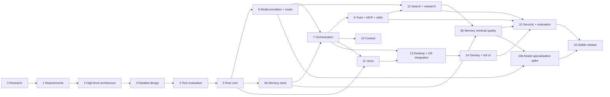

# EDITH — Implementation Roadmap

Companion: [MASTER_BACKLOG](EDITH_MASTER_IMPLEMENTATION_BACKLOG.md) (task-level) · [TESTING](EDITH_TESTING_AND_EVALUATION_PLAN.md) · [RISK_REGISTER](EDITH_RISK_REGISTER.md) · [TECHNOLOGY_DECISIONS](EDITH_TECHNOLOGY_DECISIONS.md) (gates G1–G6)

The phases follow the structure proposed in the specification, with three revisions justified by the research:

1. **Phase 6 (model provider) moves before the orchestrator** so that the orchestrator is built against real provider contracts and the Tier 0 path is proven first.
2. **Phase 9 (memory) is split** into a store-and-explorer part (before voice) and a retrieval-quality part (after search), because the explorer is needed to debug extraction.
3. **Phase 14 (overlay) carries a platform spike** (gate G3) early, because the Wayland limitation is a platform risk that can change the UI plan.

No phase is a time box. Estimates are omitted because the owner's availability is unknown (assumption A6 in [PRODUCT_VISION](EDITH_PRODUCT_VISION.md)).

## Dependency graph

### 6.1 Independence

| Can develop in parallel | Depends on |
|-------------------------|------------|
| Storage (5), events (5), observability (5) | Core types (5) |
| Model adapters (6) and memory store (9a) | Core, storage |
| Voice capture and ASR adapter (11) | Core, events |
| Search providers and fetch (12) | Models trait (6) |
| Prototype UI (already done) | Nothing; uses contracts |
| Overlay spike (14, gate G3) | Nothing; can run early |

---

## Phase 0 — Existing product research and competitor analysis

- **Objectives:** understand the landscape; find reusable projects; identify constraints.
- **Components:** research notes.
- **Dependencies:** none.
- **Implementation order:** 1.
- **Technical risks:** fast-moving projects; third-party summaries mistaken for primary sources.
- **Deliverables:** [RESEARCH_AND_COMPETITOR_ANALYSIS](EDITH_RESEARCH_AND_COMPETITOR_ANALYSIS.md) with classified claims and sources.
- **Acceptance criteria:** every technology claim classified; at least one primary source for each adopted decision; "not verified" stated where not checked.
- **Testing strategy:** source audit (spot-check 10 citations).
- **Definition of completion:** research document reviewed; open questions listed (Antigravity, Letta licence, Open Interpreter, Qwen checkpoint).
- **Status:** **Done (this pass)**; open items carried forward.

## Phase 1 — Product requirements and capability definition

- **Objectives:** define what EDITH does for v1, and what it does not.
- **Components:** requirements, capability matrix, specification analysis.
- **Dependencies:** Phase 0.
- **Order:** 2.
- **Risks:** scope creep from the specification's breadth.
- **Deliverables:** [PRODUCT_VISION](EDITH_PRODUCT_VISION.md), [PRODUCT_REQUIREMENTS](EDITH_PRODUCT_REQUIREMENTS.md), [CAPABILITY_MATRIX](EDITH_CAPABILITY_MATRIX.md).
- **Acceptance:** every requirement has an ID and a verification method; conflicts C1–C10 and assumptions U1–U8 resolved or assigned.
- **Testing:** traceability check: each FR appears in at least one backlog item.
- **Definition of completion:** owner has reviewed scope; out-of-scope list agreed.
- **Status:** **Drafted**; owner review pending.

## Phase 2 — High-level architecture

- **Objectives:** subsystem boundaries, process model, communication model.
- **Components:** architecture diagrams; subsystem list (24 subsystems).
- **Dependencies:** Phase 1.
- **Order:** 3.
- **Risks:** boundary errors that later require rewrites.
- **Deliverables:** [HIGH_LEVEL_ARCHITECTURE](EDITH_HIGH_LEVEL_ARCHITECTURE.md).
- **Acceptance:** every subsystem assigned an owner crate; process list justified; no unnecessary microservices.
- **Testing:** architecture review checklist against principles P1–P18.
- **Definition of completion:** approved boundaries; decisions AD1–AD10 recorded.
- **Status:** **Drafted**.

## Phase 3 — Detailed system design

- **Objectives:** contracts, data structures, state machines, failure modes.
- **Components:** [DETAILED_SYSTEM_DESIGN](EDITH_DETAILED_SYSTEM_DESIGN.md), [AGENT_ORCHESTRATION](EDITH_AGENT_ORCHESTRATION_DESIGN.md), [MODEL_ROUTING](EDITH_MODEL_ROUTING_DESIGN.md), [MCP_AND_SKILL](EDITH_MCP_AND_SKILL_ARCHITECTURE.md), [MEMORY](EDITH_MEMORY_ARCHITECTURE.md), [VOICE](EDITH_VOICE_ARCHITECTURE.md), [SEARCH](EDITH_SEARCH_ARCHITECTURE.md), [SECURITY](EDITH_SECURITY_AND_AUTONOMY_POLICY.md), [DATABASE](EDITH_DATABASE_DESIGN.md), [API](EDITH_API_AND_EVENT_CONTRACTS.md).
- **Dependencies:** Phase 2.
- **Order:** 4.
- **Risks:** over-specification before spikes; contradictions between documents.
- **Deliverables:** the listed documents.
- **Acceptance:** state machines have no unreachable states; every API route maps to a service method; every event kind has a producer.
- **Testing:** cross-reference check (script or review); example scenarios traced through documents.
- **Definition of completion:** documents cross-referenced; no contradictory architectures.
- **Status:** **Drafted**.

## Phase 4 — Technology and dependency evaluation

- **Objectives:** choose or defer each technology; set gates.
- **Components:** [TECHNOLOGY_DECISIONS](EDITH_TECHNOLOGY_DECISIONS.md), dependency policy.
- **Dependencies:** Phases 0 and 3.
- **Order:** 5.
- **Risks:** decisions made on popularity; unverified licences.
- **Deliverables:** decision table; gate list G1–G6.
- **Acceptance:** each decision has evidence or a gate; licences checked for adopted dependencies.
- **Testing:** spikes for G2–G5 (run in Phases 9, 11, 14).
- **Definition of completion:** decision record signed off; gates scheduled.
- **Status:** **Drafted**; gates open.

## Phase 5 — Rust core foundation

- **Objectives:** workspace, core types, configuration, events, storage with migrations, observability, daemon skeleton with health endpoint, API skeleton on a socket.
- **Components:** `edith-core`, `edith-events`, `edith-observability`, `edith-storage`, `edith-api` (skeleton), `apps/daemon`, `edith-testkit`.
- **Dependencies:** Phase 4.
- **Implementation order:** core → observability → events → storage → API skeleton → daemon → Tier 0 tools (clock, calc, system status) as the first end-to-end path.
- **Technical risks:** `sqlx` compile-time checks slowing builds (mitigation: offline mode); socket permission handling.
- **Deliverables:** running `edith-daemon` with `/v1/health`; SQLite migrations; first Tier 0 tool reachable via the API; CI pipeline (fmt, clippy, tests, cargo-deny).
- **Acceptance:** daemon starts in < 2 s on target hardware (hypothesis); health endpoint returns version; storage survives crash test; no TCP listener.
- **Testing:** unit tests on core; migration tests; socket permission test; startup benchmark.
- **Definition of completion:** CI green; first end-to-end Tier 0 request logged with trace id.

## Phase 6 — Model provider abstraction and inference

- **Objectives:** `ModelProvider` contract; Ollama and llama.cpp adapters; router with tiers; health; decision records; benchmark Qwen3 checkpoints (gate G1); Tier 1 classifier decision (D7).
- **Components:** `edith-models`, `edith-router`, benchmark harness in `edith-testkit`.
- **Dependencies:** Phase 5.
- **Implementation order:** provider trait → fake provider → Ollama adapter → contract test suite → router decision function (rules only) → health table → llama.cpp adapter → benchmark → classifier decision.
- **Technical risks:** tool-calling support varies by checkpoint and runtime; memory pressure on the owner's GPU; context length claims differ between sources (see RESEARCH §5.3).
- **Deliverables:** adapters passing contract tests; router with fallback; benchmark report for G1; decision record for D6 and D7.
- **Acceptance:** Tier 2 first-token p50 under the hypothesised 800 ms on target hardware or the target is revised with evidence; fallback works when the primary is stopped; no adapter leaks wire types outside `edith-models`.
- **Testing:** contract suite (recorded and live); router unit tests; chaos test (kill server mid-stream).
- **Definition of completion:** owner selects checkpoint for default Tier 2 and Tier 3; router produces decision records for every request.

## Phase 7 — Agent orchestration and execution

- **Objectives:** task lifecycle; planner with validation; worker execution; budgets; cancellation; checkpoints; conversation manager; activity events; policy engine (pure) and approvals.
- **Components:** `edith-orchestrator`, `edith-policy`, `edith-tools` (process runner), conversation module.
- **Dependencies:** Phases 6 and 9a (memory store for context); policy depends on Phase 5 storage.
- **Implementation order:** policy evaluator → state machine (no I/O) with property tests → event persistence → planner validation → executor → verification modes → cancellation tree → conversation manager → approvals API.
- **Technical risks:** state explosion; cancellation leaks; over-eager planning.
- **Deliverables:** end-to-end objective path with a mechanical verification example (run tests on a fixture repository); activity events; approval flow.
- **Acceptance:** all eight scenarios in the specification runnable at least in simplified form with fake providers; cancellation leaves no child process after 2 s; policy blocks `Blocked` classes in 100% of tests.
- **Testing:** state machine properties; scenario tests; fault injection; cancellation tests.
- **Definition of completion:** owner can submit an objective, see plan and verification, cancel, and approve a confirmation.

## Phase 8 — Tool and MCP ecosystem

- **Objectives:** native tool registry; MCP host (stdio and Streamable HTTP); skill registry with native, Claude Code and OpenCode adapters; capability catalogue with on-demand schemas; Antigravity investigation (gate G6).
- **Components:** `edith-tools` (full), `edith-mcp`, `edith-skills`, adapters.
- **Dependencies:** Phase 7.
- **Implementation order:** tool registry → fake MCP server → rmcp client → lifecycle supervisor → catalogue and selection → skill manifest → Claude Code adapter → OpenCode adapter → Antigravity spike.
- **Technical risks:** MCP spec and SDK version churn (the SDK README references newer protocol revisions); child process security; config format drift.
- **Deliverables:** registry UI data; MCP server states; adapter fixtures; execution history.
- **Acceptance:** owner's configured servers discovered read-only; crash restarts within 3 attempts; top-N tool selection respected in token count tests; changed skill hash blocks execution until approval.
- **Testing:** fake MCP server conformance; adapter fixture tests; lifecycle tests.
- **Definition of completion:** owner can use at least one real MCP server and one skill from their own configuration through policy.

## Phase 9 — Persistent memory and personal understanding

Split into two parts.

### 9a — Store and explorer (before voice)
- **Objectives:** memory model, write gate, provenance, explicit facts, memory explorer API and UI, review queue, FTS search.
- **Components:** `edith-memory` (store and gate), API routes, UI screens.
- **Dependencies:** Phase 5.
- **Acceptance:** all five provenance values stored and displayed; secrets rejected in 100% of test cases; edit creates a version; delete removes from search.
- **Testing:** unit and API tests; redaction tests; UI E2E.

### 9b — Retrieval quality (after search)
- **Objectives:** embeddings and vector index (gate G2); extraction pipeline with Tier 1; contradiction detection; consolidation; "Who am I?" rule; ranking weights.
- **Dependencies:** Phases 6, 12 (search increases corpus), 9a.
- **Acceptance:** retrieval precision@5 ≥ 0.8 on labelled set (hypothesis); contradiction recall ≥ 0.85 on synthetic set; zero `Inferred` items stated as fact in evaluation.
- **Testing:** labelled retrieval set; contradiction fixtures; evaluation transcripts.
- **Technical risks:** extraction noise; embedding model drift; vector index crash risk (G2).

## Phase 10 — Model specialisation and learning (dataset and evaluation first)

- **Objectives:** three stages from the specification. Stage 1 (prompting, routing, memory) is already part of earlier phases. This phase delivers **Stage 2 preparation** (dataset curation and evaluation) and **Stage 3 instrumentation** (continuous evaluation from traces). Fine-tuning training runs are not in this phase.
- **Components:** dataset export with review, evaluation harness, trace analytics, model version registry.
- **Dependencies:** Phases 6, 9b, 15 (evaluation).
- **Acceptance:** exports exclude `Secret` and unreviewed items; evaluation suite reproduces scores across runs; model version is recorded on every route decision.
- **Testing:** dataset linting; reproducibility test.
- **Technical risks:** privacy leakage in datasets; training on noisy traces; hardware cost of LoRA/QLoRA.

Note: the context-acquisition work (C30) is also scheduled here as "Phase 10 — context" in [CAPABILITY_MATRIX](EDITH_CAPABILITY_MATRIX.md). It depends on Phase 7 and is independent of the specialisation work. Treat it as Phase 10a (context) and Phase 10b (specialisation prep).

## Phase 10a — Context acquisition (environment awareness)

- **Objectives:** opt-in git and project context; collection log; "What was I working on?" with episodic memory.
- **Components:** `edith-context`.
- **Dependencies:** Phase 7.
- **Acceptance:** each source off by default; collection events visible; no capture beyond configured roots; answers cite the snapshot used.
- **Testing:** policy tests; integration with a fixture repository.

## Phase 11 — Voice and multimodal interaction

- **Objectives:** push-to-talk; streaming ASR with partials; TTS with sentence streaming; barge-in; device recovery; ASR engine choice (G4); echo test (G5).
- **Components:** `edith-voice`, voice UI.
- **Dependencies:** Phases 5, 7; UI shell from prototype.
- **Implementation order:** capture → VAD → whisper.cpp worker → partial and final events → PTT UI → TTS → barge-in → Gemini Live adapter (opt-in) → device recovery.
- **Technical risks:** echo self-triggering; CPU use of continuous ASR; Bangla accuracy; PipeWire binding maturity.
- **Deliverables:** voice session working end to end with fixture audio and on hardware.
- **Acceptance:** partial < 400 ms after onset and final < 700 ms after endpoint (hypotheses); barge-in stops speech < 150 ms; device removal recovers within 5 s.
- **Testing:** fixture audio, timing harness, hardware checklist.
- **Definition of completion:** owner completes a spoken objective and hears the spoken answer; interruption works.

## Phase 12 — Web search, browser and research capabilities

- **Objectives:** search providers; fetch; extraction; evidence; answer verification; research workflow; Phase 12a read-only browser rendering if needed.
- **Components:** `edith-search`.
- **Dependencies:** Phases 6, 7, 8 (MCP search tools optional).
- **Acceptance:** Scenario 3 (architecture research) produces a cited comparison; unsupported-claim rate < 2% (hypothesis); provider fallback exercised in tests; search outage produces a blocker report.
- **Testing:** fixture web server; research evaluation set of 40 questions; fault injection.
- **Technical risks:** provider terms and cost; quality of free sources; content extraction failures.

## Phase 13 — Desktop and operating-system integration

- **Objectives:** Tauri shell; tray; global shortcut; notifications; autostart via systemd user unit; secret service integration; single-instance behaviour.
- **Components:** `apps/desktop`, `deploy/`.
- **Dependencies:** Phases 7, 11.
- **Acceptance:** starts at login; tray status matches daemon state; notifications on completion when unfocused; secrets read from keyring.
- **Testing:** manual checklist on GNOME Wayland; automated tests for daemon-side pieces.
- **Technical risks:** GNOME Wayland behaviour; keyring availability in sessions.

## Phase 14 — Holographic overlay and full UI

- **Objectives:** overlay with modes A/B/C; core animations; expanded panel; full UI integration (conversation, activity, memory, capabilities, routing, settings); theming.
- **Components:** `apps/desktop` overlay window; `packages/contracts`; UI.
- **Dependencies:** Phase 13; prototype designs.
- **Implementation order:** **G3 spike first** (overlay modes on GNOME Wayland) → overlay window → core states → panel → full UI wiring → settings wiring.
- **Technical risks:** always-on-top on Wayland (R6); click-through; rendering cost; multi-monitor placement (tauri #14019).
- **Acceptance:** overlay mode detected and displayed; states switch within 100 ms of daemon events; idle CPU < 3% (hypothesis); reduced-motion honoured.
- **Testing:** visual snapshots; manual multi-monitor test; performance measurement.

## Phase 15 — Security, evaluation and optimisation

- **Objectives:** threat model review; policy and template fuzzing; prompt-injection suite; OS-level sandbox evaluation (R3); encryption-at-rest decision (D13); evaluation consolidation; performance tuning against [PERFORMANCE](EDITH_PERFORMANCE_REQUIREMENTS.md).
- **Components:** all; security tests.
- **Dependencies:** Phases 8, 9b, 12, 14.
- **Acceptance:** no open high-severity findings; injection suite pass rate ≥ 95% (hypothesis); all performance targets measured, with failures triaged.
- **Testing:** fuzzing, pen-test checklist, benchmark suite.
- **Definition of completion:** security sign-off by the owner; evaluation dashboard live.

## Phase 16 — Stable release and long-term development

- **Objectives:** packaging (`.deb`, AppImage), upgrade path with migrations, backup and restore, documentation for the owner, release process, roadmap for v2.
- **Components:** `deploy/`, release CI.
- **Dependencies:** Phase 15.
- **Acceptance:** clean install and upgrade from the previous release; backup restore drill passes; release notes generated; SBOM produced.
- **Testing:** install tests in a clean VM; restore drill; upgrade test from every prior schema version.
- **Definition of completion:** v1.0 tagged; owner runs EDITH daily for 14 days with no critical defects.

---

## Risks to the roadmap

| Risk | Effect | Mitigation |
|------|--------|------------|
| Owner hardware cannot run chosen Qwen checkpoint | Phase 6 slips | Gate G1 early; checkpoint options across sizes |
| Overlay on Wayland unsupported | Phase 14 scope change | G3 spike early; three modes |
| MCP SDK churn | Phase 8 rework | Wrapper trait; pinned version |
| Voice echo and accuracy | Phase 11 slips | Push-to-talk first; hardware test plan |
| Scope breadth | Delays everything | Capability matrix; out-of-scope list |
