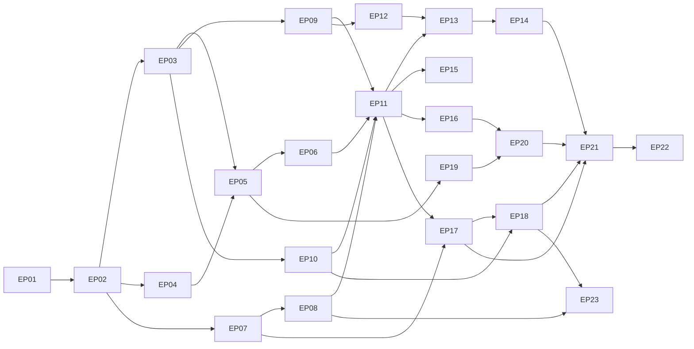

# EDITH — Master Implementation Backlog

Prepared for implementation in the local Rust project (Antigravity). Each item has an ID, phase, dependency list, requirement references ([PRODUCT_REQUIREMENTS](EDITH_PRODUCT_REQUIREMENTS.md)), and acceptance criteria. Estimates are intentionally omitted; size labels are **S** (≤ 1 day), **M** (≤ 3 days), **L** (≤ 1 week), **XL** (split before starting).

Status values: `Done` (exists in repo), `Ready` (dependencies met), `Blocked` (waiting on dependency or gate), `Planned`.

## 0. Current repository state

| Item | Status |
|------|--------|
| Design documents (`docs/edith/`) | Done (this blueprint) |
| Web prototype (`prototype/`) | Done — simulated, see [UI_UX](EDITH_UI_UX_SPECIFICATION.md) §7 |
| Rust workspace | Planned (EP-01) |
| Desktop shell | Planned (EP-13) |

## 1. Epics

| Epic | Name | Phase | Depends on |
|------|------|-------|-----------|
| EP-01 | Rust workspace and CI | 5 | — |
| EP-02 | Core types, config, events | 5 | EP-01 |
| EP-03 | Storage and migrations | 5 | EP-02 |
| EP-04 | Observability | 5 | EP-02 |
| EP-05 | Local API skeleton and daemon | 5 | EP-02, EP-03, EP-04 |
| EP-06 | Tier 0 native tools | 5 | EP-05 |
| EP-07 | Model providers | 6 | EP-02 |
| EP-08 | Router | 6 | EP-07 |
| EP-09 | Policy engine and audit | 7 | EP-03 |
| EP-10 | Memory store and explorer | 9a | EP-03, EP-05 |
| EP-11 | Orchestrator | 7 | EP-06, EP-08, EP-09, EP-10 |
| EP-12 | Command templates and process runner | 7 | EP-09 |
| EP-13 | Tools and MCP host | 8 | EP-11, EP-12 |
| EP-14 | Skill registry and adapters | 8 | EP-13 |
| EP-15 | Context acquisition | 10a | EP-11 |
| EP-16 | Voice engine | 11 | EP-02, EP-11 |
| EP-17 | Search and research | 12 | EP-07, EP-11 |
| EP-18 | Memory retrieval quality | 9b | EP-10, EP-17 |
| EP-19 | Desktop shell | 13 | EP-05 |
| EP-20 | Overlay and full UI | 14 | EP-19, EP-16 |
| EP-21 | Security hardening and evaluation | 15 | most |
| EP-22 | Packaging and release | 16 | EP-21 |
| EP-23 | Dataset and evaluation for specialisation | 10b | EP-08, EP-18 |

## 2. Backlog items

### EP-01 Rust workspace and CI
| ID | Item | Size | Deps | Refs | Acceptance |
|----|------|------|------|------|-----------|
| BL-001 | Create Cargo workspace with crate skeletons from [PROJECT_STRUCTURE](EDITH_PROJECT_STRUCTURE.md) §1 | M | — | — | `cargo build` passes |
| BL-002 | Toolchain pin, rustfmt, clippy (deny warnings), cargo-deny, cargo-audit in CI | S | BL-001 | NFR-010 | CI green on empty crates |
| BL-003 | Dependency-graph check script enforcing PROJECT_STRUCTURE §3 rules | S | BL-001 | NFR-006 | Fails on forbidden edge |
| BL-004 | Lint: forbid `sh -c` / shell construction in production code | S | BL-001 | SECURITY §6 | Test with deliberate violation fails |

### EP-02 Core types, config, events
| ID | Item | Size | Deps | Refs | Acceptance |
|----|------|------|------|------|-----------|
| BL-010 | Core domain enums and IDs (`TaskState`, `Tier`, `CapabilityKind`, `AutonomyClass`, `Provenance`, `DataClass`) | S | BL-001 | DETAILED §1 | Serde round-trip tests |
| BL-011 | TOML config schema with validation and line-precise errors | M | BL-010 | NFR-007 | Invalid configs rejected with location |
| BL-012 | Secret references by name; secret store trait | S | BL-011 | SECURITY §8 | No secret values in config dumps |
| BL-013 | Event envelope and typed bus (broadcast + bounded queues, lag signal) | M | BL-010 | FR-016 | Lag test; ordering test |

### EP-03 Storage
| ID | Item | Size | Deps | Refs | Acceptance |
|----|------|------|------|------|-----------|
| BL-020 | SQLite open with WAL, pragmas, file modes 0600/0700 | S | BL-010 | DATABASE §1 | Pragma and mode tests |
| BL-021 | Embedded migrations `0001` with backup and integrity check before migrate | M | BL-020 | DATABASE §6 | Migration test; failed migration keeps backup |
| BL-022 | Single writer task and read pool | M | BL-020 | DATABASE §1 | No busy error under load test |
| BL-023 | Repositories: tasks, task_events, subtasks, route_decisions | M | BL-021, BL-022 | FR-010, FR-005 | Replay test |
| BL-024 | Audit chain (hash-linked rows) | S | BL-021 | SECURITY §10 | Tamper detection test |

### EP-04 Observability
| ID | Item | Size | Deps | Refs | Acceptance |
|----|------|------|------|------|-----------|
| BL-030 | tracing setup, JSON log, rotation | S | BL-010 | NFR-005 | Logs written with trace id |
| BL-031 | Redaction layer for logs and traces | M | BL-030 | SECURITY §8 | Secret-pattern test |
| BL-032 | Metrics registry and histograms | S | BL-030 | PERFORMANCE §7 | Metric names documented |

### EP-05 Local API and daemon
| ID | Item | Size | Deps | Refs | Acceptance |
|----|------|------|------|------|-----------|
| BL-040 | Daemon composition root with ordered start and graceful shutdown | M | EP-02–04 | DETAILED §2 | Start/stop test; drain ≤ 5 s |
| BL-041 | axum server on Unix socket (0600), bearer token | M | BL-040 | API §1 | No TCP listener; unauthenticated request refused |
| BL-042 | `/v1/health`, `/v1/status` | S | BL-041 | API §2 | Contract test |
| BL-043 | Event stream (WebSocket with SSE fallback) | M | BL-041, BL-013 | API §3 | Event delivered; lag event on overflow |
| BL-044 | JSON Schema export and TypeScript contract generation | M | BL-041 | API §8 | Generated types compile in prototype |

### EP-06 Tier 0 native tools
| ID | Item | Size | Deps | Refs | Acceptance |
|----|------|------|------|------|-----------|
| BL-050 | Tool trait, descriptor, registry | M | BL-010 | MCP §3 | Registry lists descriptors |
| BL-051 | `clock.now` (timezone aware, default Asia/Dhaka) | S | BL-050 | FR-003 | Test with fixed clock |
| BL-052 | `calc.eval` (bounded grammar, no code execution) | M | BL-050 | FR-003 | Fuzz test; no eval |
| BL-053 | `system.status` (load, memory, disk, network summary) | S | BL-050 | FR-003 | Snapshot test |
| BL-054 | Intent patterns for Tier 0 with confidence | S | BL-051 | MODEL_ROUTING §4.2 | Table tests |
| BL-055 | End-to-end Tier 0 request via API, no model loaded | S | BL-054, BL-042 | Scenario S1 | Trace shows no model call |

### EP-07 Model providers
| ID | Item | Size | Deps | Refs | Acceptance |
|----|------|------|------|------|-----------|
| BL-070 | `ModelProvider` trait, types, errors | M | BL-010 | FR-031 | Compiles; fake implements |
| BL-071 | Contract test suite (see TESTING §3.2) | M | BL-070 | NFR-007 | Fake passes |
| BL-072 | Ollama adapter (OpenAI-compatible `/v1`) | L | BL-071 | FR-031 | Contract suite against live small model |
| BL-073 | llama.cpp server adapter | M | BL-071 | FR-031 | Contract suite |
| BL-074 | Connection pool and concurrency limit | S | BL-072 | PERFORMANCE §5 | Limit test |
| BL-075 | Health probing and status table | S | BL-072 | FR-034 | Down/Degraded transitions |
| BL-076 | Cloud adapter skeleton with consent gate (disabled) | M | BL-071, BL-012 | FR-033 | Refuses Secret; refuses without consent |

### EP-08 Router
| ID | Item | Size | Deps | Refs | Acceptance |
|----|------|------|------|------|-----------|
| BL-080 | Tier model and route decision record | M | BL-070 | FR-002, FR-005 | Record stored per request |
| BL-081 | Rule-based complexity and capability filter | M | BL-080 | FR-032 | Table tests |
| BL-082 | Fallback chains per tier from config | S | BL-081, BL-075 | FR-032 | Fallback when primary stopped |
| BL-083 | Gate G1: checkpoint benchmark harness and report | L | BL-072 | TESTING §6.1 | Report with decision |
| BL-084 | Tier 1 classifier (decision D7 implementation) | M | BL-083 | MODEL_ROUTING §12 | Accuracy on router set |
| BL-085 | Route override per task (user) | S | BL-080 | FR-035 | Override recorded with reason |

### EP-09 Policy and audit
| ID | Item | Size | Deps | Refs | Acceptance |
|----|------|------|------|------|-----------|
| BL-090 | Rule model and pure evaluator | M | BL-010 | FR-018 | Property tests |
| BL-091 | Default policy set from SECURITY §3 | S | BL-090 | FR-018 | Table tests |
| BL-092 | Decision records and audit integration | S | BL-090, BL-024 | SECURITY §10 | Audit row per decision |
| BL-093 | Approval state machine and API | M | BL-092, BL-041 | FR-019 | Approve/deny/expire tests |
| BL-094 | Fail-closed on evaluator error | S | BL-090 | SECURITY §2 | Panic injection test |

### EP-10 Memory store and explorer (9a)
| ID | Item | Size | Deps | Refs | Acceptance |
|----|------|------|------|------|-----------|
| BL-100 | Memory model, tables, provenance enum | M | BL-021 | FR-040, FR-041 | Schema test |
| BL-101 | Write gate: schema, secret rejection, dedupe | M | BL-100 | FR-044, FR-047 | Secret corpus rejected |
| BL-102 | Contradiction detection (rules first) and review queue | M | BL-101 | FR-043 | Synthetic tests |
| BL-103 | FTS5 search | S | BL-100 | FR-048 (partial) | Search test |
| BL-104 | Memory API: list, search, edit (versioned), confirm, reject, delete | M | BL-100, BL-041 | FR-045 | API tests |
| BL-105 | Working memory TTL and expiry jobs | S | BL-100 | FR-046 | Controlled clock test |
| BL-106 | Explicit-fact capture from user statements (rules) | S | BL-101 | FR-041 | Examples captured with provenance |

### EP-11 Orchestrator
| ID | Item | Size | Deps | Refs | Acceptance |
|----|------|------|------|------|-----------|
| BL-110 | Task state machine (pure) with transition table | M | BL-010 | FR-010 | Property tests: no undefined transitions |
| BL-111 | Write-ahead task events and projection | M | BL-110, BL-023 | FR-015 | Replay test |
| BL-112 | Planner with DAG validation and repair step | L | BL-110, BL-080 | FR-008, FR-013 | Invalid plans rejected |
| BL-113 | Worker execution with budgets and concurrency | L | BL-112, BL-090 | FR-013, FR-016 | Budget enforcement tests |
| BL-114 | Verification modes (mechanical, evidence, user-confirmed, none-declared) | M | BL-113 | FR-011, FR-012 | Task not completed without verdict |
| BL-115 | Retry, fallback and blocker reporting | M | BL-113, BL-082 | FR-014 | Fault-injection tests |
| BL-116 | Cancellation tree | M | BL-113 | FR-006 | No leaked child process |
| BL-117 | Conversation manager (sessions, turns, context assembly, interruption) | L | BL-111, BL-104 | FR-001, FR-007 | Scenario S8 passes with fakes |
| BL-118 | Restart recovery: resume or ask | M | BL-111 | FR-015 | Restart test |
| BL-119 | Activity events and summaries for UI | S | BL-111 | FR-017 | Event schema tests |

### EP-12 Command templates and process runner
| ID | Item | Size | Deps | Refs | Acceptance |
|----|------|------|------|------|-----------|
| BL-120 | Command template type with fixed argv and validators | M | BL-090 | SECURITY §6 | Injection tests |
| BL-121 | Process runner: env allowlist, cwd jail, rlimits, timeouts, group kill | L | BL-120 | SECURITY §6 | Limits enforced in tests |
| BL-122 | Allowlisted templates (git, cargo, npm, pytest) | S | BL-121 | FR-018 | Each template tested |
| BL-123 | Symlink-safe path validation | M | BL-120 | SECURITY §6 | Escape tests |

### EP-13 Tools and MCP host
| ID | Item | Size | Deps | Refs | Acceptance |
|----|------|------|------|------|-----------|
| BL-130 | Native fs.read / fs.write (scoped, rollback snapshot) | M | BL-123, BL-090 | FR-020 | Rollback test |
| BL-131 | git.status / git.diff tools | S | BL-121 | FR-080 | Fixture repo tests |
| BL-132 | `McpClient` trait and rmcp-backed implementation (stdio) | L | BL-050, BL-121 | FR-051 | Fake server conformance |
| BL-133 | Streamable HTTP transport with TLS and redirect policy | M | BL-132 | FR-051 | TLS refusal test |
| BL-134 | MCP lifecycle supervisor with backoff | M | BL-132 | FR-053 | Crash restart test |
| BL-135 | Catalogue cache and top-N tool selection | M | BL-134 | FR-054 | Token count test |
| BL-136 | Capability model and status API | S | BL-135 | FR-055 | Type split enforced |
| BL-137 | Execution history per capability | S | BL-136, BL-092 | FR-058 | UI data test |
| BL-138 | Gate G6: Antigravity configuration investigation | S | — | Risk R17 | Written adapter spec or deferral note |

### EP-14 Skill registry and adapters
| ID | Item | Size | Deps | Refs | Acceptance |
|----|------|------|------|------|-----------|
| BL-140 | Canonical `skill.toml` model and validation | M | BL-136 | FR-056 | Name and length rules |
| BL-141 | Skill index (descriptions only) and selection | M | BL-140 | MCP §7 | Top-3 accuracy benchmark |
| BL-142 | Hash pinning and re-approval on change | S | BL-140 | FR-057 | Changed skill blocked |
| BL-143 | Native adapter | S | BL-140 | FR-056 | Fixture tests |
| BL-144 | Claude Code adapter (`.claude/skills/*/SKILL.md`) | M | BL-143 | FR-050 | Recorded fixtures |
| BL-145 | OpenCode adapter (`opencode.json` `mcp` object, read-only) | M | BL-133, BL-132 | FR-050 | Recorded fixtures incl. malformed |
| BL-146 | Permission hints shown but not enforced as allow | S | BL-145, BL-090 | FR-055 | Policy test |

### EP-15 Context acquisition (10a)
| ID | Item | Size | Deps | Refs | Acceptance |
|----|------|------|------|------|-----------|
| BL-150 | Context source trait, collection log, snapshot model | M | BL-090 | FR-081 | Log entries per collection |
| BL-151 | Git and project sources (opt-in, configured roots) | M | BL-150, BL-131 | FR-080 | Fixture repo |
| BL-152 | "What was I working on?" answer path | M | BL-151, BL-104 | FR-082 | Scenario S8 |

### EP-16 Voice engine (11)
| ID | Item | Size | Deps | Refs | Acceptance |
|----|------|------|------|------|-----------|
| BL-160 | Capture via PipeWire binding; cpal fallback (D8 spike) | L | BL-013 | FR-063 | Device list; 1-hour soak |
| BL-161 | VAD and endpointer | M | BL-160 | FR-060 | Endpoint tests on fixtures |
| BL-162 | `SpeechRecognizer` trait and whisper.cpp worker | L | BL-161 | FR-060, FR-064 | WER baseline (G4) |
| BL-163 | Partial and final transcript events; conversation dispatch | M | BL-162, BL-117 | FR-060 | Latency harness |
| BL-164 | Push-to-talk UI integration | S | BL-163 | FR-060 | E2E |
| BL-165 | `SpeechSynthesizer` and sentence streaming | M | BL-013 | FR-061 | First-audio latency |
| BL-166 | Barge-in controller and echo evaluation (G5) | L | BL-161, BL-165 | FR-062 | Stop < 150 ms |
| BL-167 | Gemini Live adapter, opt-in, manual VAD | L | BL-162 | FR-064 | Consent test; contract test |
| BL-168 | Device hot-plug recovery | M | BL-160 | FR-063 | Unplug test |
| BL-169 | Microphone indicator and privacy controls | S | BL-160 | FR-065 | UI test |

### EP-17 Search and research (12)
| ID | Item | Size | Deps | Refs | Acceptance |
|----|------|------|------|------|-----------|
| BL-170 | `SearchProvider` trait and first adapter (owner-chosen API) | M | BL-070 | FR-070 | Contract tests |
| BL-171 | SearXNG adapter (optional, self-hosted) | M | BL-170 | FR-070 | Contract tests |
| BL-172 | Query planning, parallel queries, normalisation, dedupe | M | BL-170 | FR-071 | Parallel benefit measured |
| BL-173 | Fetcher with robots, limits, timeouts, cache | L | BL-172 | FR-072 | Fixture server tests |
| BL-174 | Extraction with span IDs | M | BL-173 | FR-073 | Golden tests |
| BL-175 | Evidence extraction and quote validation | M | BL-174, BL-070 | FR-073 | No unvalidated quotes |
| BL-176 | Answer verification (claim ↔ span) | M | BL-175 | FR-074 | Unsupported sentences flagged |
| BL-177 | Source display with tier and date | S | BL-176 | FR-075 | UI test |
| BL-178 | Research evaluation set (40 questions) | M | BL-176 | TESTING §5.2 | Score report |
| BL-179 | Read-only headless rendering (optional) | L | BL-173 | FR-076 | Policy-gated |

### EP-18 Memory retrieval quality (9b)
| ID | Item | Size | Deps | Refs | Acceptance |
|----|------|------|------|------|-----------|
| BL-180 | Gate G2: vector index evaluation (sqlite-vec vs brute force) | M | BL-100 | DATABASE §8 | Decision recorded |
| BL-181 | Embedding pipeline through provider abstraction | M | BL-180, BL-072 | FR-048 | Re-embed on model change |
| BL-182 | Extraction pipeline with Tier 1 candidates | M | BL-084, BL-101 | FR-041 | Candidate quality review |
| BL-183 | Ranking with provenance weights and tuned defaults | M | BL-181 | FR-042 | Precision@5 target |
| BL-184 | Consolidation jobs (idle only) | M | BL-183 | FR-049 | Non-interference test |
| BL-185 | "Who am I?" answer path with provenance rules | S | BL-183 | FR-042 | Scenario S2 |

### EP-19 Desktop shell (13)
| ID | Item | Size | Deps | Refs | Acceptance |
|----|------|------|------|------|-----------|
| BL-190 | Tauri v2 app shell and daemon connection | M | BL-041 | — | Connects to socket |
| BL-191 | Tray with status and quick actions | S | BL-190 | — | Matches daemon state |
| BL-192 | Global shortcut and single instance | S | BL-190 | — | Shortcut toggles overlay |
| BL-193 | Desktop notifications rules | S | BL-190 | UI §3.5 | Notification test |
| BL-194 | systemd user unit and autostart | S | BL-190 | — | Starts at login |
| BL-195 | Secret Service integration (keyring) | M | BL-012 | SECURITY §8 | Secret read in session |

### EP-20 Overlay and full UI (14)
| ID | Item | Size | Deps | Refs | Acceptance |
|----|------|------|------|------|-----------|
| BL-200 | Gate G3: overlay spike on GNOME Wayland (modes A/B/C) | M | BL-190 | R6 | Documented mode behaviour |
| BL-201 | Overlay window with mode detection and setting | M | BL-200 | UI §3.6 | Mode shown in System |
| BL-202 | Core visual with four states | M | BL-201 | UI §3.6 | Visual snapshots |
| BL-203 | Expanded panel and quick input | M | BL-202 | UI §3.6 | E2E |
| BL-204 | Port prototype screens to daemon adapters | L | BL-043, BL-044 | FRONTEND §5 | Same UI on real adapters |
| BL-205 | Activity center wiring | M | BL-204, BL-119 | FR-017 | E2E |
| BL-206 | Memory explorer wiring | M | BL-204, BL-104 | FR-045 | E2E |
| BL-207 | MCP and skills manager wiring | M | BL-204, BL-136, BL-140 | FR-052 | E2E |
| BL-208 | Routing dashboard wiring | S | BL-204, BL-080 | FR-034 | E2E |
| BL-209 | Settings sections 1–14 wiring | L | BL-204, BL-011 | FR-092 | Persistence test |
| BL-210 | Accessibility audit (axe, keyboard) | M | BL-204 | NFR-008 | Zero critical issues |

### EP-21 Security and evaluation (15)
| ID | Item | Size | Deps | Refs | Acceptance |
|----|------|------|------|------|-----------|
| BL-210a | Gate G5 echo evaluation report | S | BL-166 | R9 | Report |
| BL-211 | Policy and template fuzzing (cargo-fuzz) | M | BL-120 | TESTING §3.6 | 24 h fuzz without crash |
| BL-212 | Prompt-injection suite (100 cases) | M | BL-176, BL-115 | FR-074, SECURITY §7 | Pass ≥ 95% |
| BL-213 | OS sandbox evaluation (bubblewrap / landlock) | M | BL-121 | R3 | Decision recorded |
| BL-214 | Encryption-at-rest decision and implementation (D13) | M | BL-021 | DATABASE | Decision recorded; tests |
| BL-215 | Performance suite against PERFORMANCE targets | L | all | PERFORMANCE §8 | Report with exceptions |
| BL-216 | 24 h soak test | M | all | NFR-003 | No leak > 5% |

### EP-22 Packaging and release (16)
| ID | Item | Size | Deps | Refs | Acceptance |
|----|------|------|------|------|-----------|
| BL-220 | `.deb` and AppImage builds | M | BL-190 | D23 | Install test |
| BL-221 | Upgrade path with migration tests from every release | M | BL-021 | DATABASE §6 | Upgrade tests |
| BL-222 | Backup and restore drill tooling | S | BL-021 | DATABASE §7 | Restore passes |
| BL-223 | SBOM and release notes | S | BL-002 | NFR-010 | SBOM attached |
| BL-224 | Owner documentation and quick start | M | all | — | Reviewed by owner |

### EP-23 Dataset and evaluation for specialisation (10b)
| ID | Item | Size | Deps | Refs | Acceptance |
|----|------|------|------|------|-----------|
| BL-230 | Dataset export with review workflow and exclusions | M | BL-104, BL-114 | Vision §6 | Exports exclude Secret |
| BL-231 | Trace analytics: success rates, repeated errors | M | BL-111 | Vision §6 | Dashboard data |
| BL-232 | Model version registry on route records | S | BL-080 | D6 | Every decision has version |
| BL-233 | Reproducible evaluation harness | M | BL-215 | TESTING §8 | Same score on re-run |

## 3. Dependency graph (summary)

## 4. First sprint suggestion (for Antigravity)

Ordered, minimal, and producing a demonstrable result:

1. BL-001, BL-002, BL-010, BL-020 (workspace, types, DB open)
2. BL-040, BL-041, BL-042 (daemon with health on socket)
3. BL-050–BL-055 (Tier 0 path end to end: "what time is it" with no model)
4. BL-070, BL-071 (provider trait and contract suite with fake)

Demo at the end: `curl --unix-socket … /v1/sessions/…/messages` returns the time with trace showing no model call.

## 5. Traceability

Every FR in [PRODUCT_REQUIREMENTS](EDITH_PRODUCT_REQUIREMENTS.md) is referenced by at least one backlog item, except the following, which are scheduled as later or deferred: FR-066 (wake word), FR-076 (browser reading — BL-179 covers the optional path), FR-049 (covered by BL-184). Gaps are tracked here rather than hidden.
