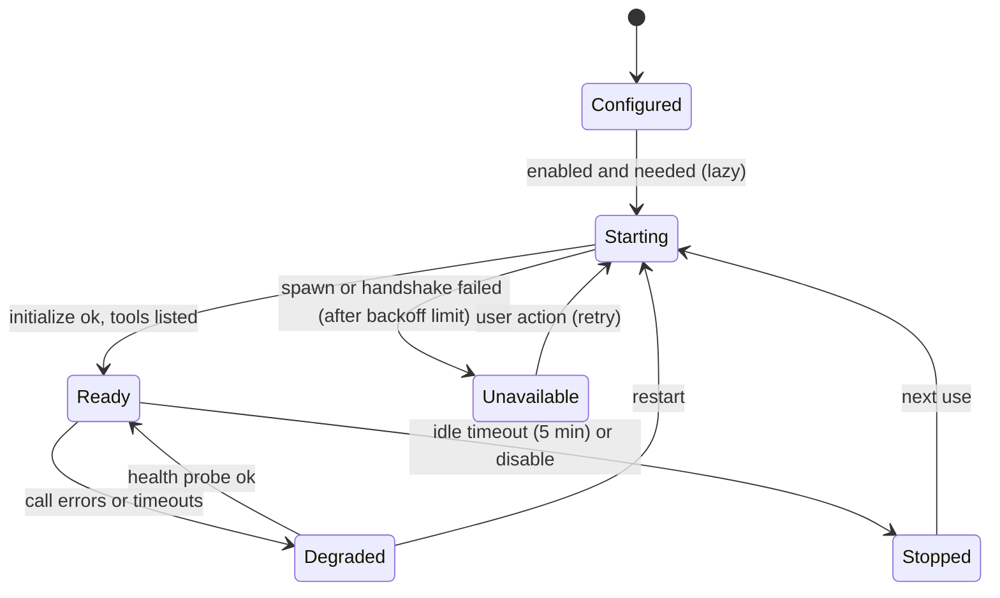

# EDITH — MCP and Skill Architecture

Companion: [TECHNOLOGY_DECISIONS](EDITH_TECHNOLOGY_DECISIONS.md) (D3, D4) · [SECURITY](EDITH_SECURITY_AND_AUTONOMY_POLICY.md) · [RESEARCH](EDITH_RESEARCH_AND_COMPETITOR_ANALYSIS.md) §3–4

## 1. Purpose

EDITH must use MCP servers and skills that the owner already has configured for tools such as Claude Code, OpenCode and Antigravity, and any future MCP-compatible application. These sources do not share one configuration format. Skills are not automatically executable. The design therefore has three parts:

1. A **canonical internal model** that distinguishes instructions, native tools, MCP tools and external services.
2. **Discovery and registries** that read each source through an adapter.
3. **On-demand loading** so that only relevant capabilities enter a model's context.

## 2. Canonical capability model

```rust
pub enum CapabilityKind {
    Instruction,      // knowledge or procedure text (a skill body, a prompt template). Not executable.
    NativeTool,       // Rust function in edith-tools. Executable, policy-gated.
    McpTool,          // tool advertised by an MCP server. Executable via MCP, policy-gated.
    ExternalService,  // a dependency that must be reachable (search API, local model, cloud speech).
}

pub struct Capability {
    pub id: CapabilityId,            // "<source>/<name>" e.g. "mcp:github/search_code"
    pub kind: CapabilityKind,
    pub name: String,
    pub description: String,         // what it does AND when to use it (≤ 1,024 chars)
    pub input_schema: Option<Json>,  // required for executable kinds
    pub output_schema: Option<Json>,
    pub side_effects: SideEffects,   // none | read | write | network | process | system
    pub required_capabilities: Vec<CapabilityId>,  // dependencies
    pub version: SemVer,
    pub source: SourceRef,           // adapter + path or server id
    pub status: CapabilityStatus,    // Available | Disabled | Unavailable(reason) | NeedsConfig(reason)
    pub autonomy: AutonomyClass,     // from policy, not from the source
}
```

Invariants:

- Only `NativeTool` and `McpTool` may be invoked. The invoke path rejects any other kind (type-level where possible).
- `autonomy` is always computed by EDITH's policy, never taken from an external file. External tool hints such as "read-only" are recorded as `source_hints` and are not trusted.
- `Instruction` capabilities can be loaded into a context; they cannot be presented as having performed an action.

## 3. Native tools

Native tools are Rust functions registered at startup with a descriptor (name, schema, side effects, default autonomy, timeout, idempotency). They are the preferred way to implement deterministic behaviour (Tier 0). Initial set is listed in [DETAILED_SYSTEM_DESIGN](EDITH_DETAILED_SYSTEM_DESIGN.md) §3.7.

Process execution uses **typed command templates** only:

```rust
pub struct CommandTemplate { id: &'static str, program: &'static str, args: Vec<ArgSpec>, cwd: CwdRule, env: EnvAllowlist, timeout: Duration }
```

Model output can fill `ArgSpec::Param` slots that have a validator (for example `path` must be inside the project root). No shell string is ever built from model output.

## 4. MCP runtime (`edith-mcp`)

### 4.1 Responsibilities

- Discover configured MCP servers from registered sources (section 6).
- Register servers with an ID, transport, auth reference and enable state.
- Manage connection state and lifecycle; restart with backoff.
- Read advertised tools, resources and prompts.
- Track capabilities and version of each server.
- Detect unavailable servers and surface the reason.
- Expose tools to the orchestrator through `Capability` records.
- Record every execution with request hash, duration, status and policy decision.

### 4.2 Transports

| Transport | Launch / connect | Notes |
|-----------|------------------|-------|
| stdio | Daemon spawns child process with `command`, `args`, `env` (allowlisted) | Child stderr captured to logs; never forwarded to the model |
| Streamable HTTP | HTTPS URL with headers from the secret store | TLS required except `localhost`; redirects not followed to other hosts without re-approval |
| Legacy HTTP+SSE | Not supported | Deprecated in MCP; use a proxy if needed |

Built on `rmcp` (decision D3). `edith-mcp` exposes its own `McpClient` trait so the SDK can be replaced.

### 4.3 Lifecycle



- Servers start **lazily** on first use, except those marked `preload = true`.
- Tool lists are cached per server version and refreshed on `tools/list_changed` notifications when the server supports them.

### 4.4 Discovery and selection

- The MCP catalogue is indexed by tool name and description. Selection uses (1) explicit user mention, (2) the router's capability hints for the step, (3) embedding similarity over descriptions when available, otherwise keyword scoring.
- The model receives only the top-N tool schemas (default 8) per model call. Full catalogues are never sent.

## 5. Skill registry (`edith-skills`)

### 5.1 Skill manifest (EDITH canonical)

```toml
# skill.toml (EDITH native) — adapters translate other formats into this
id = "repo-architecture-report"
name = "Repository architecture report"
version = "1.2.0"
description = "Analyse a code repository and produce an architecture report. Use when the user asks for architecture review, module maps or dependency analysis of a project."
kind = "instruction+tools"            # instruction | instruction+tools
instructions = "SKILL.md"             # body loaded on demand
requires = ["native:fs.read", "native:git.status", "mcp:filesystem/list_directory"]
compatibility = { edith = ">=0.1", os = ["linux"] }
enabled = true
source = { adapter = "claude-code", path = ".claude/skills/repo-architecture" }
```

### 5.2 Skill lifecycle

Discovery → parse → validate → index (descriptions only) → select → load body → resolve requirements → enable → invoke (via capabilities) → record outcome.

Validation rules:

- `id` and `name` constraints follow the Agent Skills standard where applicable (name ≤ 64 characters, lowercase, digits and hyphens, equal to the folder name).
- `description` ≤ 1,024 characters and must contain a "use when" clause; otherwise the skill is indexed with a warning.
- Every `requires` entry must resolve to a registered capability, or the skill is `NeedsConfig`.

### 5.3 Instructions versus executables

The UI and the orchestrator must never describe a skill as having performed work. A skill can:

- add instructions to the context (kind `instruction`);
- request tools that are then executed through the normal path (kind `instruction+tools`).

Scripts bundled with a skill are not executed by default. Executing a bundled script is a `process` side effect, is policy-gated, and runs inside the same command-template system after the owner approves the script's hash.

### 5.4 Versioning and compatibility

- Each skill has a SemVer version. Installed skill content is pinned by content hash; a changed hash marks the skill `Changed` and requires re-approval if it was previously enabled.
- `compatibility` declares minimum EDITH version and required OS features. Incompatible skills are listed but not enabled.

### 5.5 Enable and disable

- Per-skill toggle and per-skill tool permissions.
- Disabled skills are never indexed for selection.

## 6. Compatibility layer (adapters)

Each external source has an adapter that implements:

```rust
pub trait CapabilitySourceAdapter {
    fn id(&self) -> &'static str;
    fn discover(&self, roots: &[PathBuf]) -> Result<DiscoveryReport, AdapterError>;   // read-only
    fn translate(&self, item: &SourceItem) -> Result<Vec<Capability>, AdapterError>;   // pure
}
```

| Adapter | Reads | Translates to | Status |
|---------|-------|---------------|--------|
| `native` | `skill.toml` in EDITH's skills directory | Skills and capabilities | Phase 8 |
| `claude-code` | `.claude/skills/<name>/SKILL.md` (frontmatter `name`, `description`, `allowed-tools`, `disable-model-invocation`, `user-invocable`) and Claude Code MCP settings (format to verify, see below) | Instruction skills; `allowed-tools` recorded as hints | Phase 8 |
| `opencode` | `opencode.json` with `mcp` object: `type: local` (`command` array, `environment`, `enabled`) and `type: remote` (`url`, `headers`, `oauth`, `enabled`); per-tool permission globs under `tools` | MCP server records; permission globs become *hints* that EDITH maps to its own policy | Phase 8 |
| `mcp-native` | EDITH's MCP registry config (TOML) | MCP server records | Phase 8 |
| `antigravity` | Local configuration (location and format **to verify** on the owner's machine) | Unknown until verified | Phase 8 spike; deferred if not verifiable |
| `custom` | Plugin manifest in EDITH skills directory | Capabilities | Later |

Mapping rules:

- Permission hints from external sources (for example OpenCode's `"tools": {"my-mcp*": false}`) are **shown** in the UI and **respected conservatively**: a hint that disables a tool disables it in EDITH too; a hint that enables a tool does not bypass EDITH's policy.
- The `claude-code` MCP configuration location and format were **not verified** in this research pass; they must be confirmed against Claude Code's current documentation before implementation.

## 7. Intelligent skill selection

Pipeline for a request:

1. Intent classification (Tier 1 or deterministic patterns) produces candidate intents.
2. Skill index search over descriptions (keyword + optional embedding), top 5.
3. The top candidate is loaded only if its score exceeds the threshold; otherwise the orchestrator plans without it.
4. Required capabilities are resolved; missing ones are reported, not silently skipped.
5. The loaded instruction body is placed in the context for the relevant step only.
6. Outcome is recorded: skill id, version, success, and verifier verdict. Successful combinations feed procedural memory candidates ([MEMORY](EDITH_MEMORY_ARCHITECTURE.md) §4.3).

Example: "Analyse this repository and prepare an architecture report."
- Intent: repo analysis + report.
- Selected: `repo-architecture-report` (score 0.91).
- Requires: `native:fs.read`, `native:git.status`, `mcp:filesystem/list_directory`.
- Resolved: all three available; policy: reads inside the project root are `Automatic`.
- Plan executes; verifier checks that every module named in the report exists in the repository listing.

## 8. Failure modes

| Failure | Response |
|---------|----------|
| MCP server exits during call | Mark call failed; restart with backoff; retry only if tool is idempotent |
| Tool schema mismatch after server update | Refresh tool list; block call; notify owner |
| Skill references missing capability | `NeedsConfig`; planner excludes skill |
| Adapter parse error | Item skipped with diagnostic; other items unaffected |
| Skill body too large (> 500 lines guideline) | Warning; body loaded in sections if supported |
| Hash changed since approval | Disable skill; prompt owner to review diff |

## 9. Security requirements

- MCP child processes: no inherited environment except allowlisted keys; working directory set to a sandbox root; stdout parsed as JSON-RPC only; stderr size-capped.
- Remote MCP: TLS; no automatic redirect to a different host; auth tokens never logged.
- Skill scripts: hash-pinned; executed only through the process command-template system.
- Any tool result that contains instructions is treated as data. The orchestrator does not obey instructions embedded in tool output (prompt-injection defence; see [SECURITY](EDITH_SECURITY_AND_AUTONOMY_POLICY.md) §7).

## 10. Testing

- Adapter fixtures: recorded `SKILL.md` files, `opencode.json` samples (including malformed ones).
- Fake MCP server (stdio) implementing `initialize`, `tools/list`, `tools/call`, errors and timeouts.
- Lifecycle tests for every transition in §4.3.
- Selection benchmark on 50 labelled requests ([TESTING](EDITH_TESTING_AND_EVALUATION_PLAN.md) §6.3).

## 11. Prototype mapping

The web prototype implements the MCP manager and skill manager with simulated registries. Every item is labelled `SIMULATED` and no process or network call is made. See [UI_UX](EDITH_UI_UX_SPECIFICATION.md) §4.6.
