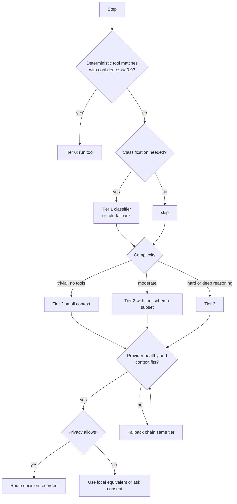

# EDITH — Model Routing Design

Companion: [AGENT_ORCHESTRATION](EDITH_AGENT_ORCHESTRATION_DESIGN.md) · [SECURITY](EDITH_SECURITY_AND_AUTONOMY_POLICY.md) · [PERFORMANCE](EDITH_PERFORMANCE_REQUIREMENTS.md) · [TECHNOLOGY_DECISIONS](EDITH_TECHNOLOGY_DECISIONS.md) (D6, D7)

## 1. Purpose

The router selects, for each step, the cheapest and fastest execution option that is **sufficient** for the step's required quality. It is one of EDITH's most important components because it determines latency, cost, privacy exposure and answer quality at the same time.

Two rules govern it:

1. **Do not over-spend.** Do not call a model when a deterministic tool answers the question.
2. **Do not under-serve.** A small model must not be forced beyond its capability. If it cannot confidently handle a step, escalate.

## 2. Routing inputs

| Input | Source | Example |
|-------|--------|---------|
| Step kind | Planner / intent classifier | `answer`, `plan`, `extract`, `summarise`, `tool-select`, `verify`, `speech-in`, `speech-out` |
| Complexity estimate | Tier 1 classifier, heuristics | `trivial`, `moderate`, `hard` |
| Required reasoning depth | Step template | `none`, `shallow`, `deep` |
| Tool-calling need | Capability set of step | yes/no |
| Context size estimate | Context assembler | tokens |
| Latency budget | Interaction mode | interactive: first token < 1 s |
| Privacy class | `DataClass` of inputs | `Public`, `Personal`, `Project`, `Secret` |
| Provider availability | Health table | up / degraded / down |
| Resource state | System status | battery, GPU memory pressure, thermal |
| User policy | Settings | cloud consent, preferred local model |

## 3. Execution tiers

| Tier | Name | Model? | Examples | Default provider |
|------|------|--------|----------|------------------|
| T0 | Deterministic | No | Time/date, calculation, system status, config lookup, DB lookup, file existence | Native Rust tool |
| T1 | Light | Small local (≈1–4B class, if configured) | Intent classification, entity extraction, query categorisation, memory-write decisions, routing hints | Ollama small model; falls back to rules |
| T2 | General | Local Qwen3 (checkpoint chosen by benchmark) | Normal chat, summaries, standard reasoning, basic tool selection, simple planning | Ollama or llama.cpp |
| T3 | Advanced | Strongest local model, or cloud if consented | Research synthesis, architecture planning, complex code, multi-step dependent calls, long documents | Local large model; cloud optional |
| T4 | Specialist | Non-LLM services | ASR, TTS, vision, code analysis, web search | Whisper, TTS engine, search provider |

Tier 0 is not a model tier in the usual sense; it is included so that every request has a tier assignment, which keeps the activity center and metrics consistent.

## 4. Decision procedure



### 4.1 Confidence and escalation

- The Tier 1 classifier returns a label and a confidence. Below **0.75** it is treated as "unknown" and the step escalates one tier.
- A Tier 2 response is checked by structural validators (JSON schema for tool calls, citation presence for evidence steps, length and refusal checks). Failure triggers one retry at Tier 3.
- The router never downgrades a step after a failure.

### 4.2 Deterministic-first matching

A table of intent patterns (for example `what time`, `what day`, `calculate <expr>`, `git status`) maps directly to T0 tools. The matcher is deterministic and tested. Ambiguous phrases go to T1 or T2. Tier 0 is never allowed to act on a request that requires writing, only read or compute.

## 5. Capability-aware routing

Each provider declares a `ModelCapabilities` record:

```text
tool_calls: native | prompted | none
json_mode: bool
streaming: bool
max_context_tokens: u32
thinking_mode: none | toggle | always
data_residency: local | cloud(region)
cost_per_1k_tokens: Option<Money>   // cloud only
measured: { first_token_ms_p50, tokens_per_s_p50 }
```

Routing rules:

- A step that needs tools is never routed to a provider with `tool_calls: none`; `prompted` tool use is allowed only for T2 steps with a validator.
- A step whose estimated context exceeds `max_context_tokens × 0.8` is routed to a larger-context provider or compacted by the context assembler first.
- `thinking_mode: toggle` models run in non-thinking mode for T1–T2 and thinking mode for T3 steps that declare `deep` reasoning.

## 6. Local and cloud policy

| Setting | Values | Default |
|---------|--------|---------|
| Cloud models allowed | off / ask-per-task / always-for-tier-3 | ask-per-task |
| Allowed data classes to cloud | Public only / Public + Project / all but Secret | Public only |
| Cloud speech | off / on | off |

- `Secret` data never goes to cloud. Enforced in the provider adapter, not only in the router.
- Each cloud call writes a route decision with `data_class`, provider, and approximate tokens. The activity center shows these.

## 7. Fallback and degraded modes

Fallback chains are declared per tier in configuration:

```text
T2: [ollama:qwen3-8b, llama_cpp:qwen3-8b-gguf, cloud:none]
T3: [ollama:qwen3-32b, llama_cpp:qwen3-32b-gguf, cloud:provider-x (if consented)]
```

Degraded modes:

- **No model available:** Tier 0 and rule-based responses continue. The conversation states that no model is available and offers the tools that still work.
- **Tier 3 unavailable:** falls back to Tier 2 with a visible quality flag ("reduced reasoning: local large model unavailable"). The task's verification mode is not relaxed.
- **Search unavailable:** evidence tasks report the blocker and list the sources they could not reach.

Health: a provider is `Degraded` after 2 consecutive errors and `Down` after 5 or a failed health probe. It is re-probed every 30 s (back-off to 5 min). Routing skips `Down` providers.

## 8. Latency and resource considerations

- Keep models warm: Tier 2 model kept loaded for 10 minutes of idle time (configurable); Tier 3 loaded on demand with a warning if load time exceeds 5 s.
- Single active generation per local model by default; queue depth limit 4; beyond that, fall back or report busy.
- Resource guard: if free VRAM or RAM falls below a threshold, Tier 3 is routed to a smaller model or deferred.

## 9. Decision record format

Every route decision is stored:

```json
{
  "route_id": "0195…",
  "task_id": "0195…",
  "step_kind": "answer",
  "tier": "T2",
  "provider": "ollama",
  "model": "qwen3:8b",
  "reason": "moderate complexity; tools subset of 3; local-only data class Personal",
  "fallbacks": ["llama_cpp:qwen3-8b-gguf"],
  "data_class": "Personal",
  "classifier": { "label": "moderate", "confidence": 0.82 },
  "latency_ms": { "queue": 4, "first_token": 640, "total": 2310 },
  "outcome": "ok"
}
```

(Model names above are examples for documentation. Real names come from configuration.)

## 10. Routing dashboard requirements

The dashboard (see [UI_UX](EDITH_UI_UX_SPECIFICATION.md) §4.7) shows:

- Selected route per task category over the last 24 hours.
- Tier distribution (how many requests were answered without a model).
- Latency percentiles per route.
- Failures and fallback events with timestamps.
- Current provider health and the reason for any degradation.

## 11. Evaluation

Router quality is measured with a labelled set of 300 requests spanning the eight scenarios and the MCP and coding examples. Metrics:

- Over-routing rate (T2+ used where T0 or T1 was sufficient) — target < 15%.
- Under-routing rate (failed verification at tier chosen) — target < 5%.
- Escalation accuracy.
- Cost and latency per correct answer.

Method and thresholds are hypotheses until the benchmark runs ([TESTING](EDITH_TESTING_AND_EVALUATION_PLAN.md) §6).

## 12. Open questions

- Whether the Tier 1 classifier should be a small LLM or a trained classifier over embeddings. Decision deferred to Phase 6 benchmark (decision D7).
- Whether thinking-mode budgets should be expressed as tokens or time. Initial choice: tokens.
