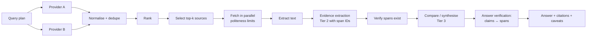

# EDITH — Search Architecture

Companion: [DETAILED_SYSTEM_DESIGN](EDITH_DETAILED_SYSTEM_DESIGN.md) §3.16–3.17 · [SECURITY](EDITH_SECURITY_AND_AUTONOMY_POLICY.md) §5 · [AGENT_ORCHESTRATION](EDITH_AGENT_ORCHESTRATION_DESIGN.md) §6

## 1. Principle

Search is not answering. The subsystem distinguishes five activities, and each has its own output contract:

| Activity | Input | Output | Verifiable? |
|----------|-------|--------|-------------|
| Search | Query | Candidate result list (title, URL, snippet, provider, rank) | Yes: result count, URL validity |
| Open / inspect | URL | Fetched document, extracted text, metadata, fetch status | Yes: HTTP status, content hash |
| Extract evidence | Document + question | Evidence spans with locations | Yes: spans must exist in the document |
| Compare sources | Evidence sets | Agreements, conflicts, source quality notes | Partly |
| Answer with evidence | Evidence + question | Answer where every claim links to ≥ 1 span | Yes: claim-to-span mapping |

A search result is **never** cited as evidence. Only extracted spans are.

## 2. Provider abstraction

```rust
#[async_trait]
pub trait SearchProvider: Send + Sync {
    fn id(&self) -> ProviderId;
    fn capabilities(&self) -> SearchCaps;   // max_results, freshness_filter, site_filter, language_filter, rate_limit
    async fn search(&self, q: &SearchQuery, cancel: CancelToken) -> Result<Vec<RawResult>, SearchError>;
}
```

Candidate providers (not yet verified in this research pass; each requires a terms-of-service and cost review before enabling):

| Provider | Type | Notes |
|----------|------|-------|
| Search API vendor (owner's choice) | Hosted API | Requires key; rate limits; billing |
| SearXNG instance | Self-hosted metasearch | Privacy-preserving; needs hosting; quality varies by upstream engines |
| MCP search server | MCP tool | Any configured MCP server exposing search; treated as a capability with the same contract |
| Direct site retrieval | HTTP fetch of a known URL | Always available; no provider needed |
| Local documents | Full-text index over owner-approved folders | Phase 12 |

## 3. Pipeline



### 3.1 Query planning

- Input: the subtask's question. Output: 1–5 queries, each with intent (`official-docs`, `comparison`, `benchmark`, `recent`, `general`).
- Independent queries run in parallel (providers permitting).

### 3.2 Normalisation and deduplication

- Canonicalise URLs (scheme, host case, tracking parameters removed, trailing slash policy).
- Deduplicate by canonical URL and by content hash after fetch.

### 3.3 Ranking and source quality

Score = relevance (provider rank + query term overlap) + authority (official documentation domains, project repositories, peer-reviewed or primary sources ranked above aggregators) + freshness (when the question is time-sensitive) − penalty (content farms, SEO list pages flagged by heuristics, duplicate summaries).

Authority tiers are configured, not hard-coded, and the owner can add or remove domains. Every source in an answer shows its tier.

### 3.4 Fetching

- Only `http` and `https`. Timeouts: connect 5 s, total 20 s. Retries: 2 with backoff, only for 5xx and network errors.
- Respect `robots.txt` for automated fetches. Per-host concurrency limit 2. Size limit 5 MB per document.
- No cookies, no authentication, no JavaScript execution in v1.
- Content-type must be text or HTML/PDF (PDF extraction is a later addition).

### 3.5 Extraction

- HTML → readable text with headings preserved (readability-style extraction). Each block gets a stable span ID: `doc_hash:block_index:char_start:char_end`.

### 3.6 Evidence extraction

- Tier 2 model is given the question and numbered blocks, and returns `{claim, span_ids[], quote_ref}`. Quotes are validated against the source text by string match; a claim whose quote does not match is discarded.

### 3.7 Answer verification

- Each sentence of the final answer must cite at least one evidence claim. Sentences without citations are removed or marked `unsupported`.
- The verifier reports: supported claims %, sources used, unresolved conflicts. The task's verification mode is `evidence` ([ORCHESTRATION](EDITH_AGENT_ORCHESTRATION_DESIGN.md) §11).

## 4. Parallelism and budgets

- Parallel: queries across providers; fetches across hosts (within limits); evidence extraction per document.
- Sequential: synthesis (depends on all evidence), verification.
- Budgets per research task: default 12 fetches, 60 k input tokens to the reasoning model, 10 minutes wall clock.

## 5. Failure handling

| Failure | Behaviour |
|---------|-----------|
| Provider timeout | Fallback to next provider in the chain; record event |
| All providers down | Report blocker; continue with direct sources if the owner provided URLs |
| Rate limit | Back-off; reduce query count; cache hit preferred |
| Fetch blocked by robots.txt | Skip; list as skipped with reason |
| Extraction empty | Mark source `unreadable`; do not cite |
| Conflicting sources | Report both with dates and authority tiers; do not average |
| Answer verification fails | Revise once; then return partial answer with unsupported parts listed |

Scenario 6 (Specification): provider becomes unavailable → detect → timeout → alternative provider → preserve task state → report genuine blocker if recovery fails. The orchestrator implements exactly this sequence.

## 6. Caching

- Search results: 24 h TTL per (provider, normalised query).
- Fetched documents: 7 d TTL with ETag / Last-Modified revalidation.
- Extracted spans: stored with the document hash; reused across tasks.
- Cache size cap: 2 GB default; LRU eviction.

## 7. Browser integration (Phase 12)

- Phase 12a: read-only rendering through an optional headless browser for pages that require JavaScript, run in an isolated profile with no stored credentials, network-restricted to the requested domain, and gated by policy per domain.
- Phase 12b: interactive browsing (clicks, form entry) is **out of scope** until a separate security review. The specification's examples do not require it.
- Candidate browser engine: Chromium via CDP (to be evaluated; not verified in this pass).

## 8. Privacy

- Queries sent to external providers are the subtask query only, not the full conversation or memory. Data class of query text must be `Public` or `Project` by default; `Personal` content is not sent to search providers without consent.
- The activity center lists each external provider call.

## 9. Metrics

- Time to first result set (p50 target 1.5 s, p95 target 4 s — hypotheses).
- Fetch success rate; extraction success rate.
- Citation validity rate (quotes match source) — target 100%, enforced by construction.
- Unsupported-claim rate in final answers — target < 2%.

## 10. Testing

- Fixture server serving HTML pages with known facts, including conflicting pages and pages with boilerplate.
- Golden tests for extraction and span IDs.
- Fault injection: slow, 500, malformed HTML, oversized responses, redirects loops.
- Evaluation set of 40 research questions with expected evidence sources ([TESTING](EDITH_TESTING_AND_EVALUATION_PLAN.md) §5.4).
