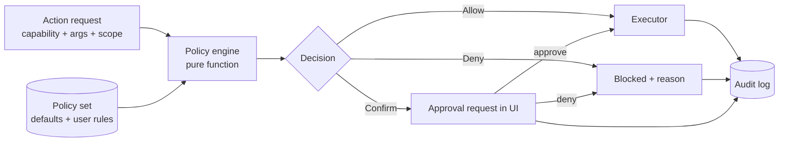

# EDITH — Security and Autonomy Policy

Companion: [MCP_AND_SKILL](EDITH_MCP_AND_SKILL_ARCHITECTURE.md) · [MEMORY](EDITH_MEMORY_ARCHITECTURE.md) · [RISK_REGISTER](EDITH_RISK_REGISTER.md) · [UI_UX](EDITH_UI_UX_SPECIFICATION.md) §4.10

## 1. Principle

EDITH should act with **maximum useful autonomy, not reckless autonomy**. Autonomy is a function of (capability, arguments, scope, data, reversibility), not a global mode. The policy engine is the only authority that can turn a request into an action.

## 2. Architecture



- The engine is pure: `evaluate(request, policy_set, context) -> Decision`. It does no I/O. Its inputs are immutable.
- The executor refuses to run any side effect without a `Decision::Allow` token that references the request hash.
- Fail closed: a policy evaluation error or a missing rule yields `Confirm` (for `write`/`process`) or `Deny` (for `system`, `network` to unknown hosts).

## 3. Autonomy classes

| Class | Meaning | Examples (from specification) |
|-------|---------|--------------------------------|
| `Automatic` | Allowed without asking; logged | Read permitted project files; search the web; retrieve memory; summarise documents; create ordinary new project files; run allowlisted development commands; inspect git status; execute approved MCP tools |
| `PolicyControlled` | Allowed when within configured limits; otherwise escalates to confirmation | Install dependencies (only in the project, only from the lockfile-declared manager); modify more than N files in one task (default 5); run privileged commands (never automatic: see §6); change system settings (see §6) |
| `ConfirmRequired` | Requires explicit approval per action (batched per task where safe) | Overwrite existing files outside the current diff; delete files; sending external communications; any `network` write to a non-allowlisted host; first use of a new MCP server's destructive tool |
| `Blocked` | Never allowed in v1 | Destructive operations on system paths; deleting large directories; exposing credentials; financial transactions; irreversible operations without a rollback point; executing arbitrary model-generated shell |

Notes:

- "Privileged commands" are blocked, not confirmed, in v1. A future privileged helper would need its own design.
- "Changing system settings" is blocked in v1, except for EDITH's own settings.

## 4. Confirmation policy

Confirmation prompts are kept rare:

- Batched: one prompt per task listing all pending approvals, with the diff or command preview for each.
- Remembered: an approval can be scoped to "this task", "this project for 7 days", or "always for this capability and path pattern".
- Previewed: every confirmation shows what will happen, where, and how to undo it.
- Timed: an unanswered confirmation pauses the task in `Waiting`; it does not time out into approval.

## 5. Capability and trust configuration

The owner configures trust per **tool**, **MCP server**, **skill** and **directory root**:

```toml
[[policy.rules]]
match = { capability = "native:fs.write", path = "~/projects/**" }
autonomy = "PolicyControlled"
limits = { max_files_per_task = 5 }

[[policy.rules]]
match = { capability = "mcp:github/*", scope = "read" }
autonomy = "Automatic"

[[policy.rules]]
match = { capability = "native:process.run_template", template = "cargo-test" }
autonomy = "Automatic"

[[policy.rules]]
match = { capability = "native:fs.write", path = "/etc/**" }
autonomy = "Blocked"
```

Rules are evaluated most-specific first. A `Blocked` rule cannot be overridden by any user rule in v1.

## 6. Command execution policy

- **No shell.** Commands are typed templates with fixed `program` and `args` arrays. `sh -c`, `bash -c`, and string concatenation of model output are forbidden. A CI lint enforces this ([TESTING](EDITH_TESTING_AND_EVALUATION_PLAN.md) §4).
- **Allowlisted templates (v1 defaults):** `git status`, `git diff`, `git log -n`, `cargo check`, `cargo test`, `cargo clippy`, `npm test`, `npm run <script declared in package.json>`, `pytest`, `ls` (scoped).
- **Parameters:** each parameter has a validator: path must resolve inside an allowed root (after symlink resolution); no `..` escape; no option injection (`--` separator for user-provided values); length limits.
- **Environment:** cleared, then allowlisted (`PATH`, `HOME`, `LANG`, `CARGO_HOME`, etc.). Secrets are never injected unless the template declares them.
- **Resource limits:** wall-clock timeout, output size cap (1 MB), `RLIMIT_AS` and `RLIMIT_CPU` where supported, process group kill on cancel.
- **Network:** templates declare whether network is allowed. Default: no.
- **Sandboxing:** v1 uses process-level restrictions (rlimits, cwd jail, no shell). Full OS-level sandboxing (for example bubblewrap or landlock) is a Phase 15 item. Risk R3.

## 7. Prompt-injection and untrusted content

- All content from the web, files, MCP results, and emails is **data**. The orchestrator attaches a provenance tag (`untrusted:web`, `untrusted:file`, …).
- Instructions found inside untrusted content do not change policy, task objective, or tool choice. The planner is prompted to ignore them, and the policy engine does not read model output as authority.
- Tool-call arguments that originated from untrusted content are subject to a stricter policy: write actions require confirmation.
- Evaluation includes an injection test suite ([TESTING](EDITH_TESTING_AND_EVALUATION_PLAN.md) §5.6).

## 8. Credentials and secrets

- Stored in the desktop Secret Service (libsecret/GNOME Keyring) when available; fallback is an encrypted file with a key derived from a passphrase entered at start (decision D12).
- Referenced by name in configuration. Never written to TOML, logs, traces, prompts, or memory.
- Redaction filter applied to logs, traces and diagnostic exports (pattern-based and by known secret values).
- Secrets passed to MCP servers only through their declared environment entries.

## 9. Data classes and egress

| Class | Examples | Local model | Cloud model | Search provider | Memory |
|-------|----------|-------------|-------------|-----------------|--------|
| Public | Public docs, general questions | Yes | Yes if consented | Yes | Yes |
| Project | Repository code, project notes | Yes | Only if consented for Project | Only subtask query | Yes |
| Personal | Facts about the owner, calendar (future) | Yes | Only if consented per task | No by default | Yes |
| Secret | Keys, tokens, passwords, private keys | Yes (never in prompts) | Never | Never | Never |

Egress is recorded: destination, data class, bytes, purpose, and the policy decision ID.

## 10. Audit log

- Append-only table `audit_events` with hash chaining (each row stores the hash of the previous row) so tampering is detectable.
- Records: request, decision, reason, approver (owner or auto), outcome, duration, related task and trace.
- Owner can view and export the log. Retention default 180 days; configurable.

## 11. Rollback

- Before any `fs.write` or patch application, EDITH records file hashes and stores the previous content in a rollback snapshot under the task directory.
- Git-tracked projects: EDITH prefers writing on a branch or creating a stash-free snapshot commit only if the owner enables that mode. It never rewrites history.
- Rollback is available from the activity center for tasks completed within 7 days.

## 12. Limits (defaults)

| Limit | Default |
|-------|---------|
| Files modified per task | 5 before confirmation |
| Bytes written per task | 2 MB |
| Process runs per task | 20 |
| Network requests per research task | 12 fetches, 40 search calls |
| Task wall-clock | 15 min interactive |
| Model spend per day (cloud) | owner-set; default 0 (cloud off) |

## 13. Threat model (summary)

| Threat | Mitigation |
|--------|-----------|
| Malicious web page instructs EDITH to exfiltrate files | Untrusted tagging; no authority from content; egress policy; write confirmation |
| Compromised MCP server | Environment allowlist; hash-pinned skills; per-tool trust; process isolation |
| Model hallucinates a dangerous command | No shell; templates only; parameter validation |
| Local attacker reads the database | File modes; optional encryption; secrets outside DB |
| Local attacker connects to the daemon | Unix socket permissions; per-session token; no TCP |
| Owner accidentally approves a broad change | Diff previews; per-task batching; limits |
| Supply-chain attack in dependencies | Locked dependencies; `cargo audit`/`cargo deny` in CI; SBOM at release |

## 14. Security testing

- Policy engine property tests (no `Allow` for `Blocked` classes; deterministic output).
- Template fuzzing for argument injection.
- Injection corpus replayed against planner and executor.
- Pen-test checklist before any public release (Phase 15).
