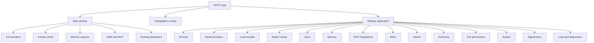

# EDITH — UI and UX Specification

Companion: [FRONTEND_DESIGN_SYSTEM](EDITH_FRONTEND_DESIGN_SYSTEM.md) · [API_AND_EVENT_CONTRACTS](EDITH_API_AND_EVENT_CONTRACTS.md) · [SECURITY](EDITH_SECURITY_AND_AUTONOMY_POLICY.md) · Prototype: `prototype/` (see §7)

## 1. Experience model

EDITH's interface communicates three things at all times: **what it is doing**, **how sure it is**, and **what it needs from the owner**. The conversation is one surface. The activity center, overlay and settings are the others. They share one data model, so a task seen in the overlay is the same task seen in the activity center.

Layout rule: the conversation is the default focus; supporting information appears beside the conversation, not in modal stacks.

## 2. Information architecture

Main window navigation (left rail): Conversation · Activity · Memory · Capabilities · Routing · Settings · (Overlay toggle).

## 3. Primary surfaces

### 3.1 Conversation

- Layout: a single column, maximum width 760 px, centred; right panel shows "Now" (current task summary) when a task is running.
- Message types: owner message, EDITH answer (streams), system notice (route change, fallback, blocker), approval card, evidence card (sources), task card (collapsed by default: objective, state, progress, cancel).
- Every EDITH answer shows a small route footer: tier chip, model name, data-class chip (`Local` or `Cloud`), elapsed time. Clicking opens the route detail.
- Input: multi-line text field (Enter sends, Shift+Enter newline), attach-context toggle (explicit only), voice button, cancel button active while a task runs.
- Follow-ups: when a message refers to a previous task ("continue that"), a chip shows the linked task.

### 3.2 Voice input affordances

- Push-to-talk button (hold to talk, or tap to toggle, configurable).
- Live caption strip above the input while listening: partial text in muted colour, becoming solid when final.
- Level meter: thin bar, 15 Hz updates.
- Microphone indicator in the status bar whenever the microphone is open.
- Speaking state: a small waveform in the conversation header; a stop button is always visible.

### 3.3 Activity center

Purpose: explain what EDITH is doing without showing raw reasoning.

Sections:

1. **Objective** — one sentence and the verification mode (`mechanical`, `evidence`, `user-confirmed`, `none-declared`).
2. **Plan** — a vertical list of subtasks with state icons, dependencies drawn as indented connectors, and durations.
3. **Active route** — current tier, model, provider health, data class.
4. **Tools** — tool and MCP invocations with arguments summary (no raw payload), status, duration.
5. **Recent operations** — timeline of `task_events` in human language ("Searched 2 providers, 14 results", "Read 3 sources", "Verified 5 of 6 claims").
6. **Errors and recovery** — each failure with the recovery action taken.
7. **Verification** — criteria with verdicts and evidence references.
8. **Completion** — outcome, changed files (with rollback), sources, and what could not be resolved.

Interaction: expandable rows; "Cancel task" in the header; filters by state; search within the task.

### 3.4 Settings application shell

- A separate window (desktop) or a full-view route in the prototype.
- Left list of 14 sections in the order defined in §2. Search box at top filters settings by label.
- Each section: title, one-line purpose, then grouped controls. Controls that take effect immediately are labelled "Applies now"; others show "Restart daemon" where relevant.
- Destructive settings use confirmation dialogs with the consequence stated.

### 3.5 Notifications

- Desktop notifications only for: task completed (if the window is not focused), confirmation required, provider down for more than 5 minutes, microphone lost.
- In-app: a single status line for transient information. No toast stacks.

### 3.6 Holographic overlay

Purpose: an ambient presence that shows state at a glance, lightweight and unobtrusive.

Visual elements:

- **Core:** a circular, softly animated form about 96 px in diameter. Idle: slow breathing motion. Listening: ring pulses with input level. Thinking: rotating segments at constant speed. Speaking: radial bars following output level. Error: a single amber ring, no flashing.
- **Caption:** one line below the core showing the current partial transcript or the current step label, truncated with an ellipsis.
- **Notifications:** at most two, auto-dismiss after 6 s, stacked to the right of the core.
- **Expanded panel:** click the core to open a panel (320 × 420 px) with the conversation's last three turns, text input, cancel and "Open main window".

Behaviour rules:

- Never blocks clicks on applications behind it except on its own panel and core (click-through on transparent areas where the platform supports it).
- Visibility modes: always visible, visible only while a task runs, hidden (tray only).
- Position: user-chosen corner; remembers monitor by name.
- Motion: respects reduced-motion setting (static core with colour-only state changes).
- Performance budget: under 3% CPU idle and under 150 MB RSS for the overlay webview (targets, to be measured).

Platform modes (see [RISK_REGISTER](EDITH_RISK_REGISTER.md) R6):

| Mode | Used when | Always-on-top guarantee |
|------|-----------|-------------------------|
| A — Layer surface | A supported compositor protocol is available | Strong |
| B — XWayland window | Running under XWayland or X11 | Good (window manager dependent) |
| C — Normal window | Fallback | None; "keep on top" is a best-effort hint, shown as such in settings |

The owner sees the active mode in Settings → System.

Aesthetic constraints: the overlay uses the same tokens as the main app; no decorative neon borders; no heavy blur effects over transparency (a reported rendering limit).

## 4. Settings and secondary screens

Each section lists: purpose, controls, states, and empty/error states. Controls in the prototype are interactive where marked.

### 4.1 General
- Owner name (used only as a display label), timezone (default `Asia/Dhaka`), language of the interface (English in v1), start at login, close-to-tray.
- Profile presets (inspired by OpenJarvis presets): `Focused` (minimal interruptions), `Builder` (coding tools enabled), `Researcher` (search and evidence), `Quiet` (no voice, no notifications).

### 4.2 Model providers
- List of providers with type (local server, cloud), state (`Up`, `Degraded`, `Down`, `Not configured`), last probe time, and data-class consent.
- Add provider: type, endpoint URL (localhost by default), secret reference (name only), test connection button.
- Cloud providers show a consent panel: which data classes are sent, approximate spend limit (default 0).

### 4.3 Local models
- Installed models (from the provider's model list), size, quantisation, context length, tool-calling support as declared or "unknown".
- Load/unload, keep-warm duration, default model per tier.
- Benchmark status: "Not benchmarked" until the Phase 6 gate.

### 4.4 Model routing
- Tier table (T0–T4) with the chosen provider/model per tier and fallback chain (drag to reorder).
- Escalation threshold (default 0.75) and cloud policy summary.
- "Test routing" field: enter a sample request, see the decision and reason without executing it.

### 4.5 Memory explorer (and memory settings)
- Layout: left filters (category, provenance, status, source, date range), centre list with search, right detail pane.
- Each item: content, category badge, provenance badge (`Explicit`, `Inferred`, `Temporary`, `Assumption`, `Outdated`), confidence bar, sources list, created/updated, related items.
- Actions: edit (creates a new version), confirm (for inferred), reject, delete (with confirmation), link.
- Review queue tab: contradictions and inferred candidates, side by side.
- Settings: retention, working-memory TTL, inferred-item review period, "forget everything" (double confirmation).

### 4.6 Skills and MCP manager
- Two tabs: **MCP servers** and **Skills**. A single view of all capabilities, grouped by source.
- MCP server card: name, transport (stdio or HTTP), state (`Ready`, `Starting`, `Degraded`, `Unavailable`, `Stopped`), reason when not ready, tool count, last call status.
- Expanded MCP: tool list with description, side-effect class, autonomy (from policy), per-tool toggle; resources and prompts; execution history (last 20 calls with duration and outcome).
- Skill card: name, version, kind (**Instruction** or **Instruction + tools**), source adapter (Claude Code, OpenCode, native), compatibility, enabled toggle, content hash status (`Approved` or `Changed — review`).
- Type badges: `Instruction` (grey), `Native tool` (blue), `MCP tool` (cyan), `External service` (violet). The badge makes the difference between knowledge and execution visible.
- Empty state: "No MCP servers configured. EDITH reads configurations from your EDITH registry, and read-only from OpenCode and Claude Code configuration locations you approve."

### 4.7 Routing dashboard
- Summary cards: requests in 24 h, share answered without a model (Tier 0/1), median first-token latency, fallback events.
- Table: task category → selected route → success rate → median latency.
- Timeline of fallback and degradation events.
- Filter by tier, provider and data class.

### 4.8 Voice configuration
- Input device (list with level test), ASR engine (local Whisper / cloud Gemini Live with consent), model and language hints, custom vocabulary.
- Output device, voice (engine-specific), speaking rate, barge-in on/off, echo protection note.
- Listening mode: push-to-talk (default), toggle, continuous (later).
- Privacy: microphone indicator (always on), diagnostic recording (off).

### 4.9 Search configuration
- Providers with order, enabled flag, rate limit, and test query.
- Authority tiers: list of domains with tier; add and remove.
- Fetch limits: fetches per task, size, timeout; robots.txt respected (read-only setting, shown as on).
- Cache: TTLs and size cap; clear cache button.

### 4.10 Autonomy and permissions
- Policy matrix: rows are capability groups (read files, write project files, run allowlisted commands, network read, network write, install dependencies, delete files, system changes); columns are scopes (inside project, inside home, elsewhere). Each cell shows the autonomy class; cells are editable where the policy allows (`Blocked` cells are read-only with a lock icon and an explanation).
- Limits: files per task before confirmation, process runs per task, wall-clock budget.
- Approval history and "Trust for 7 days" list with revoke.

### 4.11 Tool permissions
- Per-tool and per-MCP-tool toggles, with the same autonomy classes; overrides shown with a dot and a link to the policy rule.
- Import hints from OpenCode or Claude Code are shown as "external hint — not enforced as allow".

### 4.12 System
- Daemon status, version, API version, socket path (copy button), storage usage, database backup status, overlay mode (A/B/C), autostart, GPU and RAM visibility (read-only), and "Restart daemon".

### 4.13 Appearance
- Theme: dark (default), light, system. Accent: cyan (default), blue, neutral. Density: comfortable, compact. Reduced motion. Font size scale.

### 4.14 Logs and diagnostics
- Log stream with level and subsystem filters; search; pause.
- Trace view: select a task, view spans with durations.
- Export diagnostic bundle (redacted). Preview before export shows what is removed.

## 5. States and feedback

| Situation | Visual response |
|-----------|-----------------|
| Working (any) | Single subtle pulse on the status dot; no spinner walls |
| Waiting for approval | Amber approval card with preview; task paused |
| Provider degraded | Route chip turns amber; system notice in conversation |
| Blocked | Red blocker card with evidence and the next action |
| Completed | Green check on task card; outcome summary |
| Offline model | Conversation shows available deterministic tools; no fake answers |

Rule: a state must never be shown that the system does not know. Unknown states show "unknown" with the last known time.

## 6. Writing style for EDITH's messages

- Short, direct sentences. No filler. No apologies for normal operation.
- State outcomes first, then evidence, then next action.
- Examples: "Done. 3 files changed; tests pass (42/42)." · "Blocked: search providers A and B timed out. Retrying B in 60 s, or provide URLs."
- Questions only when a decision is needed and the policy requires it.

## 7. Prototype specification

The web prototype (`prototype/`) implements the surfaces above with these honesty rules:

1. A persistent **SIMULATED** label appears in the header and on every panel backed by mock data.
2. No network calls to model, search, or MCP endpoints.
3. No microphone or camera access. Voice controls show state transitions only.
4. Responses are generated by a deterministic rule-based simulator, labelled as such.
5. Settings values persist only in the browser session (memory).
6. The Tier 0 clock and calculator are real computations in the browser, labelled Tier 0.

Scenes covered: conversation with simulated task, activity center, overlay (all four core states), memory explorer, skills and MCP manager, routing dashboard, and settings sections 1–14.

## 8. Accessibility

- Keyboard: all actions reachable; visible focus ring; `Ctrl+K` command palette (later), `Esc` closes panels.
- Contrast: text at least 4.5:1; large text at least 3:1.
- Screen readers: landmarks for main, navigation and settings; live regions for task state changes (polite) and blockers (assertive).
- Motion: reduced-motion removes continuous animation.
- Colour is never the only signal: badges include text.
