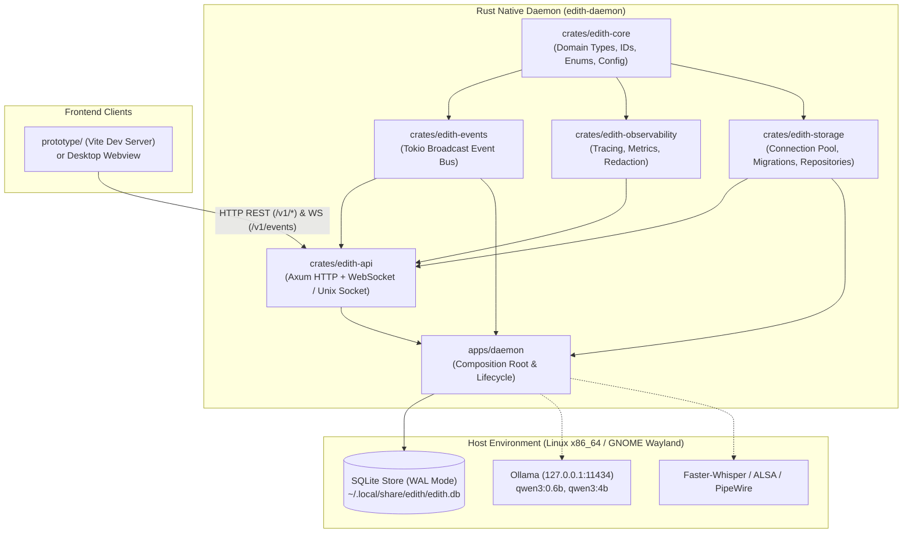

# EDITH 2.0 — Repository Audit & Baseline Verification
**Audit Date:** 2026-11-03  
**Auditor:** Principal Software Architect & Systems Lead  
**Scope:** Complete repository audit, toolchain verification, environment analysis, prototype assessment, and baseline component classification.

---

## 1. Executive Summary

A comprehensive audit was performed across the repository, the 24 Arena.ai architectural and engineering blueprint specifications in `docs/edith/`, the interactive web prototype in `prototype/`, and the target Linux host environment.

The repository originated from a clean Git pull of `https://github.com/mdadeel/friday.git` at commit `0f1f107`. Prior to this audit, the repository contained:
1. **Architecture & Design Blueprint (`docs/edith/`):** 24 detailed markdown documents and an index covering vision, requirements, high-level and detailed architecture, orchestration, routing, MCP/skills, memory, voice, search, security, database design, API contracts, design tokens, UI/UX specifications, project layout, decisions (D1–D24), roadmap, and risk register.
2. **Interactive Prototype (`prototype/`):** A fully structured React 18 + TypeScript + Vite web application implementing the holographic visual design, navigation, token system, mock service layer, and 19 deterministic unit tests for Tier 0 evaluation, task state transitions, and memory rules.
3. **No Native Implementation:** No Rust workspace, crates, binaries, or database implementations existed. The backend was 100% simulated in TypeScript.

The host environment is an **AMD Ryzen 5 5600GT with Radeon Graphics** on **Ubuntu 26.04.1 LTS** under **GNOME Wayland**, with local **Ollama** (pre-loaded with `qwen3:0.6b`, `qwen3:4b`, `qwen2.5:3b-instruct`), cached **faster-whisper** models, and Node.js v24.20.0. The Rust toolchain (`rustc 1.99.1`, `cargo 1.99.1`) was configured and verified during this audit.

---

## 2. Environment & Host Hardware Audit

| Attribute | Detected Value | Engineering Implication |
|-----------|----------------|-------------------------|
| **OS & Distribution** | Ubuntu 26.04.1 LTS (Linux kernel 6.17.0) | Standard modern Linux runtime; glibc compatible; systemd user daemon compatible |
| **Desktop / Display** | GNOME Shell on Wayland (`XDG_SESSION_TYPE: wayland`) | Transparent click-through overlay requires XWayland or native desktop windowing (Wayland layer-shell protocol is not supported on stock GNOME Mutter without extensions) |
| **CPU** | AMD Ryzen 5 5600GT (6 cores / 12 threads) | Capable CPU inference for Tier 0/1; must manage thread affinity and avoid saturating all cores during ASR or local LLM inference |
| **GPU / VRAM** | Integrated Radeon Graphics (shared RAM) | No dedicated large VRAM pool; CPU/integrated GPU shared memory makes 0.6B to 4B quantized models optimal; 7B+ will induce high memory pressure |
| **Memory (RAM)** | 16 GB Total (~13 GiB usable, 9.5 GiB available, 10 GiB swap) | Memory budget must be strictly enforced. Concurrently running Whisper + 4B LLM + desktop shell must remain under 6-8 GB total footprint |
| **Rust Toolchain** | `rustc 1.99.1` / `cargo 1.99.1` (stable-x86_64-unknown-linux-gnu) | Fully functional and modern; supports edition 2021 / 2024; clippy and rustfmt available |
| **Node / Web Toolchain** | Node.js v24.20.0, npm 11.11.0, TypeScript 5.6.3 | Fast builds, ES modules native, modern web APIs |
| **Local LLM Engine** | Ollama running at `127.0.0.1:11434` | Models verified present: `qwen3:0.6b`, `qwen3:4b`, `qwen2.5:3b-instruct`, `qwen2.5:0.5b-instruct-q4_K_M` |
| **Local Speech / Audio** | Faster-Whisper cached weights in `~/.cache/huggingface/hub/` | Models present: `tiny.en`, `base.en`, `base`, `small.en`, `small`, `medium`; binary `isle-whisper` present in `~/.local/bin/` |

---

## 3. Repository Component Classification

| Component | Path | Current State | Quality / Usability | Classification & Action |
|-----------|------|---------------|---------------------|-------------------------|
| **Design Documents** | `docs/edith/*.md` | Complete (24 docs) | High architectural rigor; clear requirement IDs and contracts | **Preserve as Source of Truth**. Maintain implementation docs in `docs/implementation/` |
| **Frontend Prototype UI** | `prototype/src/` | Complete simulated prototype | High quality visual system, glassmorphism, responsive components | **Preserve & Adapt**. Decouple from mock adapters to consume live API |
| **Frontend Design Tokens** | `prototype/src/styles/` | Complete (`tokens.css`, `app.css`) | Consistent color palette, typography, status badges, layout rules | **Preserve as Official Design System** |
| **Prototype Logic Tests** | `prototype/tests/` | 19 passing tests | Validates intent parser, arithmetic, memory precedence, approvals | **Preserve & Maintain** as contract validation tests |
| **Rust Workspace** | Root `Cargo.toml` | Missing | N/A | **Implement in Phase 1** |
| **Core Types (`edith-core`)** | `crates/edith-core` | Missing | N/A | **Implement in Phase 1** |
| **Event Bus (`edith-events`)**| `crates/edith-events`| Missing | N/A | **Implement in Phase 1** |
| **Storage (`edith-storage`)** | `crates/edith-storage`| Missing | N/A | **Implement in Phase 1** |
| **Observability (`edith-observability`)** | `crates/edith-observability` | Missing | N/A | **Implement in Phase 1** |
| **API Server (`edith-api`)** | `crates/edith-api` | Missing | N/A | **Implement in Phase 1** |
| **Daemon (`apps/daemon`)** | `apps/daemon` | Missing | N/A | **Implement in Phase 1** |
| **Desktop Shell** | `apps/desktop` (Tauri) | Missing | N/A | **Planned for Phase 10/11** |

---

## 4. Component Dependency Map

---

## 5. Audit Conclusions & Immediate Actions

1. The prototype passes all 19 tests and accurately reflects the UI/UX specifications. It should not be thrown away or rewritten.
2. The core system architecture in `docs/edith/` is sound and directly implementable in modular Rust crates.
3. The smallest viable, meaningful first vertical slice is **Phase 1: Workspace & Application Foundation**:
   - Create the Cargo workspace.
   - Implement `edith-core` (IDs, domain types, configuration schemas, error types).
   - Implement `edith-events` (in-process typed event bus with lag handling).
   - Implement `edith-storage` (SQLite initialization in WAL mode, embedded migrations, connection pooling, task & event repositories).
   - Implement `edith-api` (Axum server providing `/v1/health`, `/v1/status`, bearer authentication, and WebSocket event stream).
   - Implement `apps/daemon` (composition root, signal handling, graceful shutdown).
   - Verify with comprehensive Rust unit and integration tests.
